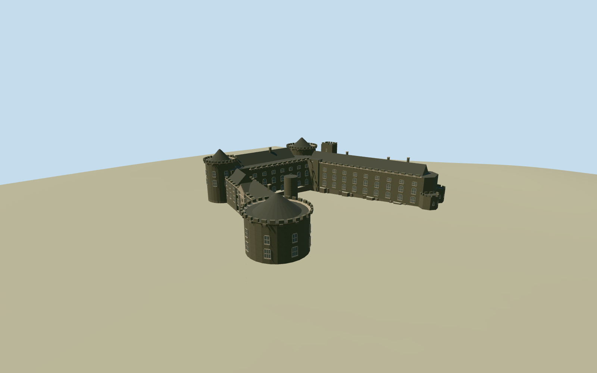

# Kilkenny Castle

Kilkenny Castle’s restored three-wing limestone exterior, circular towers, slate roofs, castellated parapets and Parade arch.

Authoring state: **review-in-qa.json**. Current completion evidence is in [qa.json](qa.json) and the [completion ledger](../../../../qualla-structures/batches/qualla-004.PROGRESS.md).

- [Kilkenny Castle](https://qualla.com/kilkenny-castle/)

The restored castle exterior and gateway are represented. Independent grounds structures and the lost medieval fourth wing are outside the asset.

The map gives current footprints and nominal heights. Traceries, concealed roof sections, corbels and textures use photo-based estimates.

Build: `node content/worldgen/source/places/gc/gc6/kilkenny_castle/models/generate-kilkenny-castle.mjs`. Add `--check` to verify exact regeneration. 19356 triangles; 5 materials; no embedded photographs.
