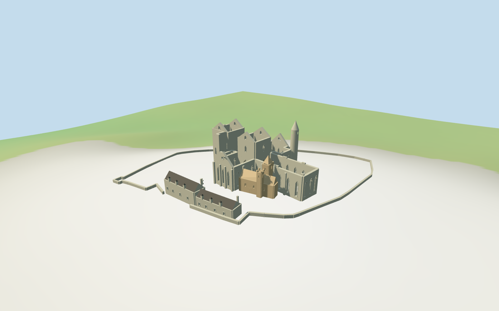

# Rock of Cashel

Rock of Cashel compound: Gothic cathedral ruins with real open lancets and roofless interiors, taller ruined west tower-house, open crossing tower/gables, narrow round tower with stone conical cap, rotated Cormac chapel with unequal paired belfries, roofed Vicars ranges and low site boundary.

## Evidence and reconstruction

Published dimensions and reconstructed details are separated in spec.json. Primary references:

- [Reference](https://heritageireland.ie/assets/uploads/2020/03/Rock-of-Cashel-Aerial-View.jpg)
- [Reference](https://heritageireland.ie/assets/uploads/2020/03/Rock-of-Cashel.jpg)
- [Reference](https://heritageireland.ie/assets/uploads/2020/03/Rock-credit-Waterford-County-Council-exp.-Oct-2028.png)
- [Reference](https://content.skyscnr.com/m/292d8aa8204d7029/original/GettyImages-dv656005_doc.jpg?crop=1048px%3A699px&quality=100)

Four existing canonical shared graphs supply weathered limestone, sandstone, slate and plain wood. No unique bitmap or embedded image.

## Model and axes

17,460 triangles; 52,380 vertices; 4 material groups; 2,098,144 bytes. Native bounds: -60.986, -6.193, -68.206 to 53.122, 29.200, 62.922. Source hash: `sha256:95cbb71f44a369add0038d47fd5abeb75c79bc3baf0cac84ea11e61b9030e90e`.

{"x":"+east","y":"+up","z":"+south"}

Current named PMTiles cathedral and Cormac chapel polygons, separate round tower and two lower ranges control individual component fit. The retained Q1255597 enclosure supplies the low site boundary. Native east/south axes contain all plan rotations; placement heading0 avoids rotating them again. Heights, damage, detailed hill strata and exact floor/path joins remain approximate.

## Reproduce

Run `node packages/worldgen/scripts/generate-additional-landmarks.mjs --ids=rock_of_cashel` (or add `--check`). The generator preserves manually edited masters by checking their baseline hashes. Import through the standard authored-model workflow with optimization disabled; then capture all QA cameras, including shared-surface views.

## Pending work

- Heights, ruined crest shapes, wall thickness, window cadence, portal detail and roof sections are picture-led approximations, not a measured conservation reconstruction.
- The retained terrain is coarse and smooths the limestone hill. Footings and low enclosure walls follow it; exact terrace, floor and visitor-path joins remain unverified.
- Selected cross is schematic. Cemetery inventories, individual carvings, frescoes, scaffolding, visitor/service huts, furnishings and certified walkable collision are excluded.
- Physical laptop and phone frame-rate measurements remain pending.

This bundle follows the medium-fi standard. Medium-fi appearance and geographic fit are reviewed separately. Hash-bound visual acceptance is recorded separately after capture inspection.

## Additional geographic data

© OpenStreetMap contributors; Protomaps; Mapzen/USGS terrain tiles.
