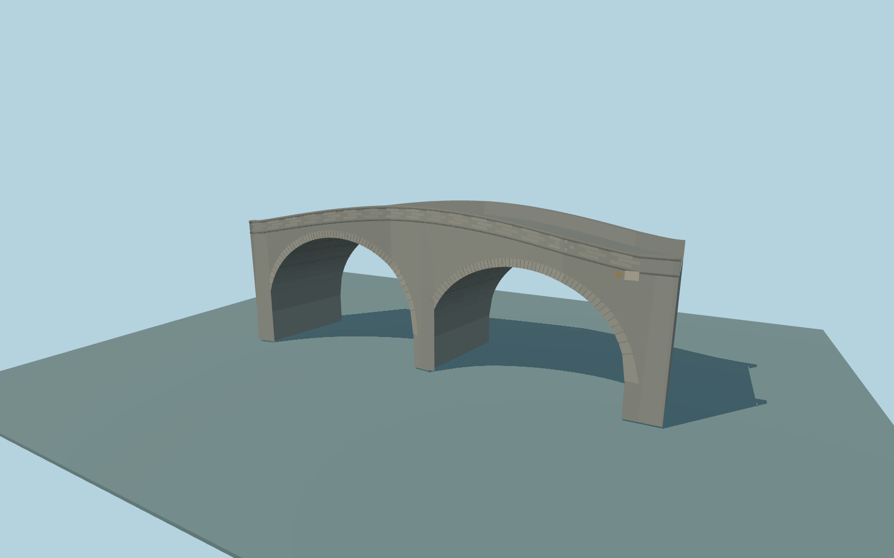

# Broom Bridge

Complete individual Broom Bridge exterior: separate open canal/towpath and railway skew masonry arches, curved broad granite spandrels, pale radial arch stones and dark barrel joints, full narrow humped roadway/eastern sidewalk, continuous stone parapets with dark coping, small battered pier faces and plain canal-side commemoration panels.

Rebuild: `node packages/worldgen/scripts/generate-broom-bridge.mjs`;append `--check` for exact source bytes. Select import/LOD/placement with `--ids=broom_bridge`. Detailed source and four browser tiers are separate ignored GLB outputs.

Fixed35m standard model datum. Approximate gently humped road rises from39.6..40.0m at its ends to41.55m near the middle. Short end shoulders flatten to meet the mapped road and sidewalk. Standard review water samples 35.390m. The coarse ground field is below the bridge bank road, so the native renderer supplies graded approaches. Vault rise, masonry thickness and foundation levels are ordinary-photo exterior proportions; these elevations fit the standard viewer and are not a survey.

Two ordinary photos and current PMTiles guide this original medium-fi exterior. Vault curvature, skew, masonry/tint variation, plaque and medallion shapes without readable text, road/sidewalk allocation, parapets and buried foundations are approximate. No copied photo pixels, downloaded meshes, graffiti, interiors, vehicles or invented readable labels. Railway infrastructure, canal banks, station and modern footbridge remain native; their global terrain and water fit is coarse. Physical laptop/phone timing measurements remain pending.

Original geometry:repository license. Map:© OpenStreetMap contributors,ODbL-1.0;Protomaps. Standard terrain:terrain-grid.json. Ordinary pictures stay local and are not redistributed or used as textures. Current acceptance:qa.json.
