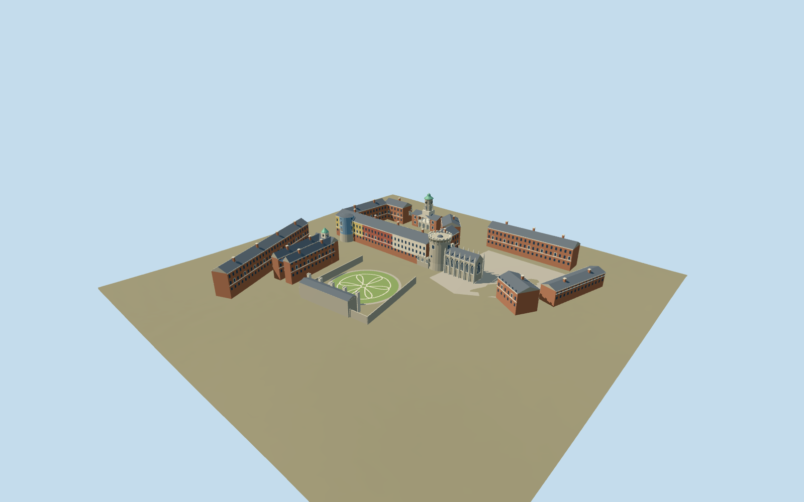

# Dublin Castle

Dublin Castle current exterior campus: open Georgian Upper and Lower Courts, Bedford clock pavilion and flanking gates, round Record and Bermingham towers, pinnacled Gothic Chapel Royal, circular Dubh Linn garden, Coach House and Chester Beatty clock range.

## Evidence and reconstruction

Published dimensions and reconstructed details are separated in spec.json. Primary references:

- [Reference](https://dublincastle.ie/wp-content/uploads/2017/01/DublinCastle_Maps_website.pdf)
- [Reference](https://dublincastle.ie/strategicframeworkplan/)
- [Reference](https://dublincastle.ie/the-medieval-tower/)
- [Reference](https://dublincastle.ie/the-chapel-royal/)
- [Reference](https://dublincastle.ie/the-bedford-tower-castle-gates-guard-house/)
- [Reference](https://dublincastle.ie/the-clock-tower-building-the-state-stables/)
- [Reference](https://dublincastle.ie/the-castle-gardens/)
- [Reference](https://www.buildingsofireland.ie/buildings-search/building/50910292/dublin-castle-bermingham-tower-dublin-castle-dublin-2-co-dublin)
- [Reference](https://www.openstreetmap.org/way/350242806)

No third-party geometry, photograph or bitmap texture is embedded. Shared surface graphs come from the central library; vertex tints carry model colors. Glazing uses PBR materials; transparent surfaces are declared per model.

## Model and axes

10,239 triangles; 30,717 vertices; 7 material groups; 1,232,732 bytes. Native bounds: -128.607, -1.803, -118.216 to 117.691, 38.500, 106.406. Source hash: `sha256:8ede701f4a7ed4a1c541d3a5566585c1fccb521c7c56fed4c85bb18eff042682`.

{"up":"+Y","longitudinal":"+X east-northeast,12.49 degrees north of east","front":"+Z gardens; -Z Dame/Castle Street; Lower Court toward +X","origin":"Site anchor; Y0 standard PMTiles working datum."}

The inspected aerial picture confirms the Georgian brick quadrangle, green Bedford clock dome, medieval Record tower/chapel pairing and southern round garden. Standard viewer PMTiles and the retained campus outline determine approximate scale, location and signed orientation. Structures use a reconstructed4.5m working rise to clear the coarse northern ground; foundations extend below terrain and low court/garden surfaces follow the sampled ground. Anchor -6.266610512,53.342658821; heading 0.217908808734; standard PMTiles datum 13.959391147912555m. Floors are reconstructed and foundations extend below the coarse sampled ground.

## Reproduce

Run `node packages/worldgen/scripts/generate-signature-towers.mjs --ids=dublin_castle` (or add `--check`). The generator preserves manually edited masters by checking their baseline hashes. Import through the standard authored-model workflow with optimization disabled; then capture all QA cameras, including shared-surface views.

## Pending work

- Approximate current exterior from picture and standard viewer PMTiles; no bespoke research, survey or exact thresholds.
- Original detailed architectural recipe and master remain preserved. Independent derivative fits foundations and coarse court/garden ground surfaces.
- Open courts, Georgian ranges, Bedford dome/gates, round medieval towers, Gothic chapel and circular garden define identity; fine carving and openings reconstructed.
- Existing exterior campus only; neighboring offices, future proposals, temporary events and navigable interiors excluded. Garden serpent paths are stylized; exact paint colors and paving remain approximate.
- Five shared material graphs and two local slots; seven merged groups justified by the mixed campus. No embedded images. Physical-device timing pending.
- The broad campus paving sheet is omitted from the runtime derivative to avoid hiding the garden; discrete courts, lawn, ring and stylized paths follow coarse PMTiles ground.

This bundle follows the medium-fi standard. Medium-fi appearance and geographic fit are reviewed separately. Hash-bound visual acceptance is recorded separately after capture inspection.

## Additional geographic data

© OpenStreetMap contributors, ODbL-1.0. OPW, Grafton and NIAH primary references used as research only.
