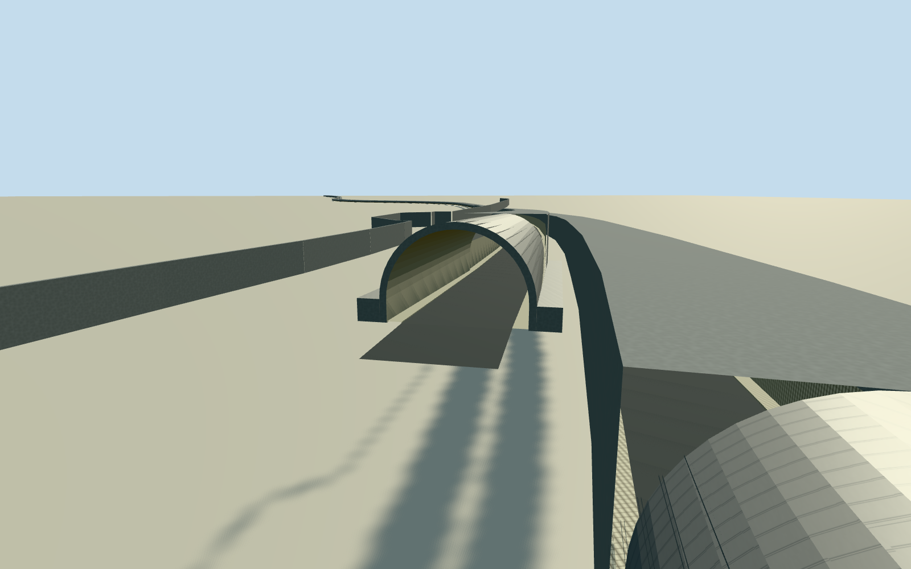

# Dublin Tunnel

Whole native twin Dublin Tunnel:69/73-control complete physical tube axes, circular bored and rectangular cut-cover shell sections, all four true open portal mouths with curved silver canopies/liner reveals/intrinsic approach decks and native19-control northern retaining wall. Native road axes are location controls only; physical walls/grade/transition boundaries/other-end canopy detail are explicit estimates. Exact published Sarah7772006PD portal/2008PD liner photos and primary technical dimensions; no roadway/property extrusion or single-mouth truncation.

Authoring state: **review-in-qa.json**. Current completion evidence is in [qa.json](qa.json) and the [completion ledger](../../../../qualla-structures/batches/qualla-002.PROGRESS.md).

- [Dublin Port Tunnel](https://qualla.com/dublin-port-tunnel/)

Both complete native underground M50 road alignments provide exact tube-location axes only: southbound way23007012/69 controls, northbound129662536/73 controls. Cross-sections/wall thickness/grade/portal canopy surfaces are explicit reconstructed physical architecture, never claimed native wall polygons or an extruded surface building.

Whole physical twin Dublin Tunnel on native142 total route controls, including both north/south portal ends and intrinsic canopies/retaining-wall structures. Bored and cut-cover sections from primary technical dimensions, explicit bounded grade and unseen end details. Native road axes are location controls, not building/wall measurements. No wider motorway/property pad/detached service/control building/road-sign/car/street object or navigable interior.

Original field frozen before once-only four mouth surface samples and fixed32m interior sag/normalized section profile. These samples do not establish actual road invert or surveyed cover; section/crown/threshold contact unverified. Floor/grade/mainsections/nativeframe/sourcefield fixed thereafter, preview/replacementfalse.

Both complete native routes and all four portal ends retained. Primary technical dimensions define original tube/cut-cover sections; native road centrelines are not measured tube/canopy wall polygons. Grade, cut-cover boundaries, lining thickness and unseen three portal canopies/current equipment are bounded original estimates; no surveyed invert/crown cover or exact current upgrades claimed.

Only exact published Sarah7772006portal/2008liner own public-domain originals supply imagery. Technical operator/TII text used for facts only; no protected diagram/image pixels, wider motorway/toll plaza/neighborhood/vehicles/signage/detached control building or detailed navigable interior. Skyline uses angular closed triangular subsurface tube mass and simplified open canopies; district has coarse sections and local mouth lining, detailed levels have complete inner shell and asphalt deck.

Original8192m129field/64mgrid/zoom12raw tiles/frame/floor/fixed grade and main cross-sections immutable before geometry. Whole buried tubes are exposed in isolated model fixtures; original source field is preserved and ordinarily conceals them. No field fitting/flattening/reframe/reacquisition/replacement/raising. Threshold/crown/foundation contact unverified; geographic preview/replacement false.

Build: `node content/worldgen/source/places/gc/gc7/dublin_port_tunnel/models/generate-dublin-tunnel.mjs`. Add `--check` to verify exact regeneration. 19058 triangles; 4 materials; no embedded photographs.
