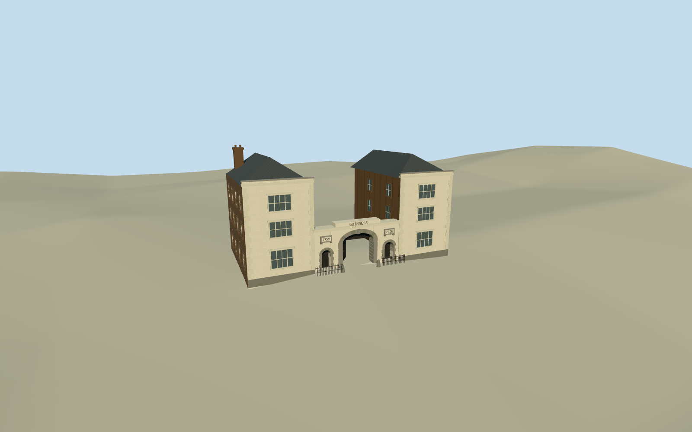

# Guinness Brewery, St. James’s Gate

St. James’s Gate at the Guinness Brewery, with three rusticated granite arches, timber fanlights, the date plaques and two three-storey lodges.

Authoring state: **review-in-qa.json**. Current completion evidence is in [qa.json](qa.json) and the [completion ledger](../../../../qualla-structures/batches/qualla-004.PROGRESS.md).

- [Guinness Brewery](https://qualla.com/guinness-brewery/)

The model covers the main James’s Street entrance and its gate lodges. The larger operating brewery and separate Storehouse building are beyond this model’s footprint.

Roof lines, glazing reflections, the carved keystone head and door joinery are simplified. The date panels represent the standing annual signage.

Build: `node content/worldgen/source/places/gc/gc7/guinness_brewery_st_james_gate/models/generate-guinness-brewery-st-james-gate.mjs`. Add `--check` to verify exact regeneration. 6352 triangles; 6 materials; no embedded photographs.
