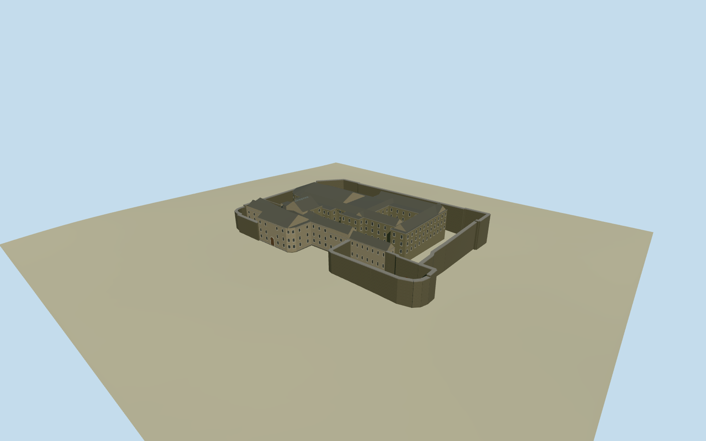

# Kilmainham Gaol

The current Kilmainham Gaol museum, with its high rubble-limestone enclosure, historic ranges, governor’s front court and surviving Stonebreakers’ Yard.

Authoring state: **review-in-qa.json**. Current completion evidence is in [qa.json](qa.json) and the [completion ledger](../../../../qualla-structures/batches/qualla-004.PROGRESS.md).

- [Kilmainham Gaol](https://qualla.com/kilmainham-gaol/)

The outer wall and connected building silhouettes are tied to current map data. Roof pitches, wall height transitions, internal bay alignment, and smaller openings are estimated from the architectural inventory and the story photograph.

The former courthouse is a separate neighbor and interiors are outside the exterior model.

Build: `node content/worldgen/source/places/gc/gc7/kilmainham_gaol/models/generate-kilmainham-gaol.mjs`. Add `--check` to verify exact regeneration. 26106 triangles; 8 materials; no embedded photographs.
