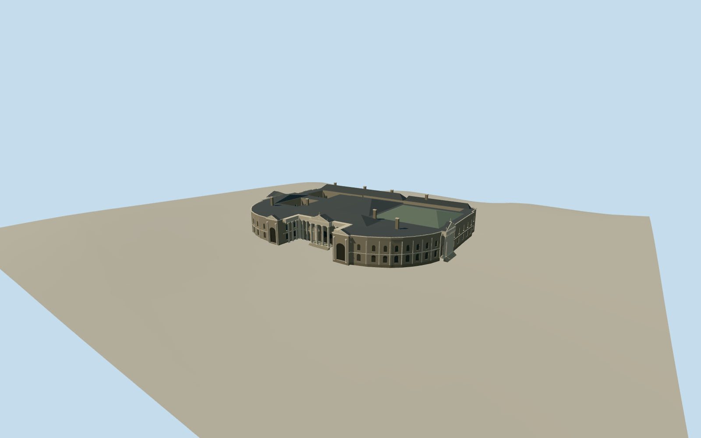

# Parliament House, Dublin

Dublin Parliament House with an open College Green colonnade, curved screen walls, three pedimented porticoes and two rear courts.

Authoring state: **review-in-qa.json**. Current completion evidence is in [qa.json](qa.json) and the [completion ledger](../../../../qualla-structures/batches/qualla-003.PROGRESS.md).

- [Parliament House, Dublin](https://qualla.com/parliament-house-dublin/)

The former Parliament House is modeled in its May 2024 bank-era appearance. The 2024 Foster Place photograph and earlier south engraving control visible street elevations.

The outline and two internal courtyards follow the named mapped building. Roof sections, lesser elevations, carvings and the east portico use the descriptions in the heritage record and estimated proportions.

The original composite elevation field is preserved and the historic ground contact is approximate.

The exact Qualla references stay in the local image corpus with their hashes and provenance in the model record.

Build: `node content/worldgen/source/places/gc/gc7/parliament_house_dublin/models/generate-dublin-parliament.mjs`. Add `--check` to verify exact regeneration. 12809 triangles; 6 materials; no embedded photographs.
