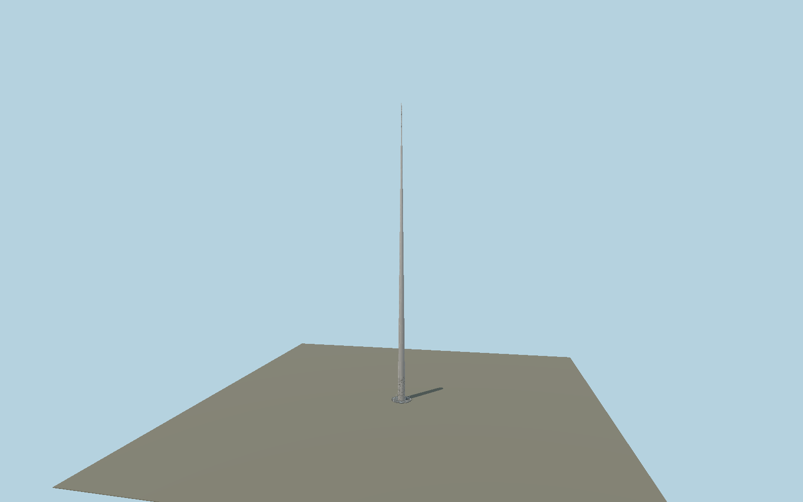

# Spire of Dublin

Tapered 120 m stainless steel monument, separate reflective geological pattern islands, 11,884 actual tip perforations with plate reveals and internal diffuser, concentric base grating, dark stone surround and eight removable bollards. Reusable polished and bead-blasted material graphs supply the metal finishes.

## Identity and geometry

Catalog spire_of_dublin, [Q1134365](https://www.wikidata.org/wiki/Q1134365). Dublin City Council and fabricator dimensions fix the 120 m cone, 3 m base and 150 mm tip. IMOA fixes 11,884 holes of 15 mm diameter over the upper 12 m. Surround/grating/bollards are scaled from the inspected architect photograph, not a site survey.

Native +X east,+Z south,+Y vertical; heading0 preserves cardinal axes around the mapped circular exact-Q1134365 monument. The cone and grating are axial; reconstructed stencil marks and eight regularized bollards have no certified compass phase. No entrance bearing is asserted.. +Z south-facing review axis; +Y is up. The geographic proposal identifies its anchor and orientation evidence separately from remaining terrain and azimuth uncertainty.

Source facts and measured references are recorded in spec.json. References: [1](https://www.visitdublin.com/the-spire), [2](https://aqua-design.ie/case-studies/the-spire-dublin/), [3](https://www.imoa.info/molybdenum-uses/molybdenum-grade-stainless-steels/architecture/stainless-steel-spire-graces.php), [4](https://www.publicart.ie/fileadmin/user_upload/PDF_Folder/The_Spire_of_Dublin_-_Science_and_Technology_in_Action.pdf), [5](https://www.newsteelconstruction.com/wp/making-the-dublin-spire/), [6](https://www.openstreetmap.org/way/96578181). Reference pages and images are not redistributed.

## Original source and shared materials

Geometry is authored in `packages/worldgen/scripts/spire-of-dublin-model.mjs`. Shared material graphs with metric repeat UV0 and original vertex tints; GLB PBR fallback remains self-contained. No per-model texture duplication. No third-party mesh or photograph is embedded.

1,313,806 triangles; 2,538,454 vertices; 5 material groups; 14,914,312 source bytes. Source hash: `sha256:48e30d716fe4469c297f1baa44eaabf1baa2ee8b2bae2f461b4ae6046724c6aa`. Geometry validation checks finite Float32 coordinates, indices, triangle area and winding before export.

Regenerate with `node packages/worldgen/scripts/generate-heritage-towers.mjs spire_of_dublin`; add `--check` for reproducibility. The generator refuses to overwrite a master whose hash differs from source.json. Import uses `--no-optimize` to preserve facade recesses.

## Remaining detail and review

- Medium-fi static daylight exterior:120m,3m base and0.15m tip follow fabricator/tourism engineering facts. Exact11884physical15mm holes remain in the original instanced master; budgeted close-up substitutes11884opaque daylight diffuser marks, street/district average subpixel perforations. Base artwork is original geological-strata reconstruction with reduced marks at distance, not a traced full architect stencil or a certified azimuth. Surround8.1m and eight regularized bollards follow inspected early architect photograph, not a current street survey; current grating/bollard phase, maintenance hatches, night beacon and wind animation are outside this daylight scope. Map2.2m ring/121.2m height are not sizing controls. Host terrain sets street datum; no footprint replacement or surrounding streets/rails baked in.

Named near/far cameras are included for lit visual review. A valid export is not maximum-fidelity certification.
