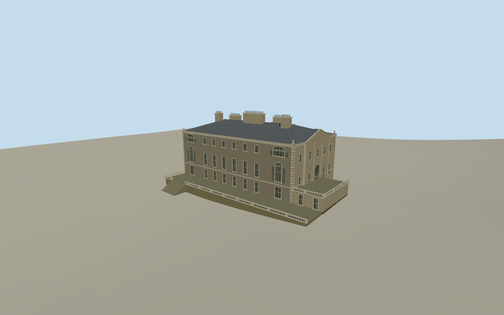

# Westport House

Grey limestone Palladian house, low slate roof with large chimney stacks, south pediment and lake-facing balustraded terraces.

Authoring state: **review-in-qa.json**. Current completion evidence is in [qa.json](qa.json) and the [completion ledger](../../../../qualla-structures/batches/qualla-003.PROGRESS.md).

- [Westport House](https://qualla.com/westport-house/)

The two exact Qualla images show the south and west faces in Easter weekend 2011. Camera timestamps give April 23. The boating-lake caption gives Easter Sunday.

The named footprint fixes the manor’s principal mass. The attached lake terrace and south lower extension, upper roof offsets, north elevation and small carved details are approximate. The east doorcase and attic follow the heritage inventory.

The independent original elevations are unchanged. Terrace contact and water-level registration are approximate. The lake, park and separate stable complex are outside the asset.

Build: `node content/worldgen/source/places/gc/gc9/westport_house/models/generate-westport-house.mjs`. Add `--check` to verify exact regeneration. 11033 triangles; 6 materials; no embedded photographs.
