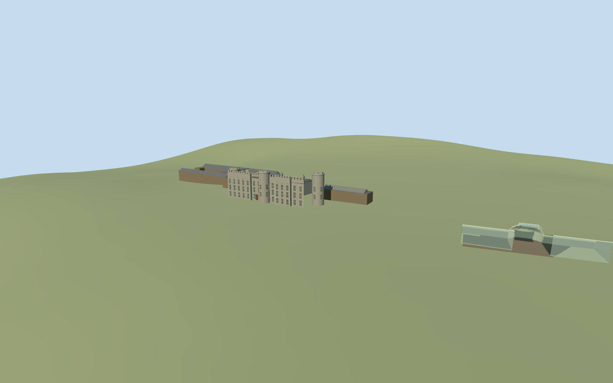

# Ardgillan Castle

Ardgillan Castle’s battlemented Gothic fronts and round towers, open service courts and Victorian conservatory with a domed plant house.

Authoring state: **review-in-qa.json**. Current completion evidence is in [qa.json](qa.json) and the [completion ledger](../../../../qualla-structures/batches/qualla-003.PROGRESS.md).

- [Ardgillan Castle](https://qualla.com/ardgillan-castle/)

Standing country house and service ranges with the rose garden conservatory. The remote park outbuildings, garden planting, icehouse and interiors are outside the modeled footprint.

Roof heights, proportions of minor rear openings and the exact grey render finish are approximate. The 13-bay frontage and slate roof concealed by battlements follow the national inventory and photographs.

The conservatory uses its named footprint and the original photograph. Minor glazing divisions and the foundation bench are estimated.

Build: `node content/worldgen/source/places/gc/gce/ardgillan_castle/models/generate-ardgillan-castle.mjs`. Add `--check` to verify exact regeneration. 9039 triangles; 7 materials; no embedded photographs.
