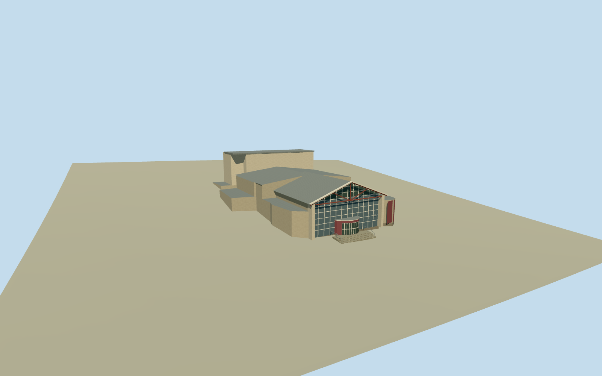

# An Grianán Theatre

The Letterkenny theatre with a glazed gable, exposed roof braces and a curved entrance.

Authoring state: **review-in-qa.json**. Current completion evidence is in [qa.json](qa.json) and the [completion ledger](../../../../qualla-structures/batches/qualla-004.PROGRESS.md).

- [An Grianan Theatre](https://qualla.com/an-grianan-theatre/)

The front colours and entrance represent the cleared 2007 image before the 2014 renovations.

The rear and secondary wings follow the mapped outline. Unpublished exterior heights, cladding and openings are approximate.

Build: `node content/worldgen/source/places/gc/gcf/grianan_theatre/models/generate-grianan-theatre.mjs`. Add `--check` to verify exact regeneration. 1915 triangles; 6 materials; no embedded photographs.
