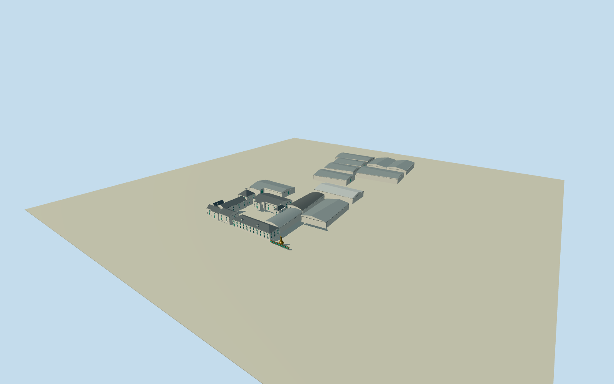

# Bruichladdich Distillery

Complete22building Bruichladdich compound on original plans and approximate uphill floor terraces: whitewash/greenframeproduction and long hipped-slate visitor front/dormers, highpyramidkilnwithgenuinelyopenventcupola, chimneys/flues, separate gabled/roundroofwarehouses and opencourts; intrinsic copper swan-neck still and turquoise-ended barrel display. No villagebuildings, naturalshore/water/groundslab, people/vehicles/lettering or interiors.

Authoring state: **review-in-qa.json**. Current completion evidence is in [qa.json](qa.json) and the [completion ledger](../../../../qualla-structures/batches/qualla-002.PROGRESS.md).

- [Bruichladdich Distillery](https://qualla.com/bruichladdich-distillery/)

Original named industrialsite366391920/Q51908 establishes Bruichladdich identity and bounded compound, not a single roof/building to extrude.22originalindividualbuildingperimeters inside it carry all actual near/master building plans. Named visitorcentre366391925east-southeast facade edge fixes signed native frame, original hipped/gabled/round roof tags and1/2/3level metadata retained. Outside villagehouses/hall/shop and every structureCatalogcandidate/member excluded. Sitecourts remain open; hidden roofpartitions/section heights and unmapped outdoorstill registration are explicit photo/nativebased estimates.

Original dry visitor pavement datum and complete raw field frozen before geometry. Explicit approximate per-building floor terraces retain inland rise; no source terrain flattening or fitted replacement surface. Provider pixels may blend structures/vegetation, and exact foundations/host terrain/shore contact remain unverified.

Three exact already-published QuallaLaddie09own-workPDselforiginals inspected and nativeSHA1matched, pinned primary creator releases bound.2008wholefront/courtyard and2002widecoastalroofline control original medium-fi geometry. Unrelated/caskcloseup/otherlicensed imagery unused; no supplemental or generated bitmap, copied photograph texture or lettering.

All22individualbuilding master perimeters retained, native1/2/3level and gabled/hipped/round roof tags respected. Historic frontage roof partition, kiln/cupola detail, concealed new warehouse doors/windows, section heights and small modern equipment are photographic/native estimates. Named industrial parcel is identity only, never a solid roof or ground slab; working courts stay open.

Explicit approximate floor terraces use photographed connected-front thresholds and the independently frozen coarse provider field for concealed uphill warehouse estimates. Provider pixels may blend structures/vegetation; exact individual floor/footing/hostshore contact remains unverified. Original raw terrain is not flattened or fitted. Flat stageY-1.1shows architecture, not certified hillside contact.

Outdoor copper still and barrel display are intrinsic photographed exterior features, with approximate courtyard registration/scale; no interior stillhouseequipment. Copper exit mouth and kiln vent cupola are real openings, other windows/doors closed behind frames. Representative simplified machinery/repeat census and unlettered turquoise barrel ends; no trademarks/signage, village buildings or natural shoreline.

Build: `node packages/worldgen/scripts/generate-authored-places.mjs --ids=bruichladdich_distillery`. Add `--check` to verify exact regeneration. 26006 triangles; 6 materials; no embedded photographs.
