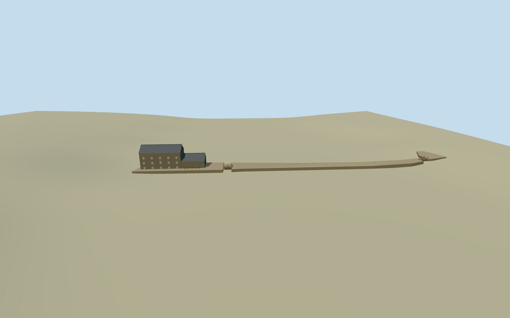

# Carew Tidal Mill

The limestone and slate Carew Tidal Mill, its lower wing and the stone causeway with two gated crossings.

Authoring state: **review-in-qa.json**. Current completion evidence is in [qa.json](qa.json) and the [completion ledger](../../../../qualla-structures/batches/qualla-004.PROGRESS.md).

- [Carew Tidal Mill](https://qualla.com/carew-tidal-mill/)

The photographs establish the pond elevation and barrier appearance. The opposite elevation, exact stone courses, gate fittings and unpublished section heights are approximate.

Terrain is unchanged. Water levels and the operation of the floodgates and milling mechanisms are outside the model scope.

Build: `node content/worldgen/source/places/gc/gch/carew_tidal_mill/models/generate-carew-tidal-mill.mjs`. Add `--check` to verify exact regeneration. 6303 triangles; 7 materials; no embedded photographs.
