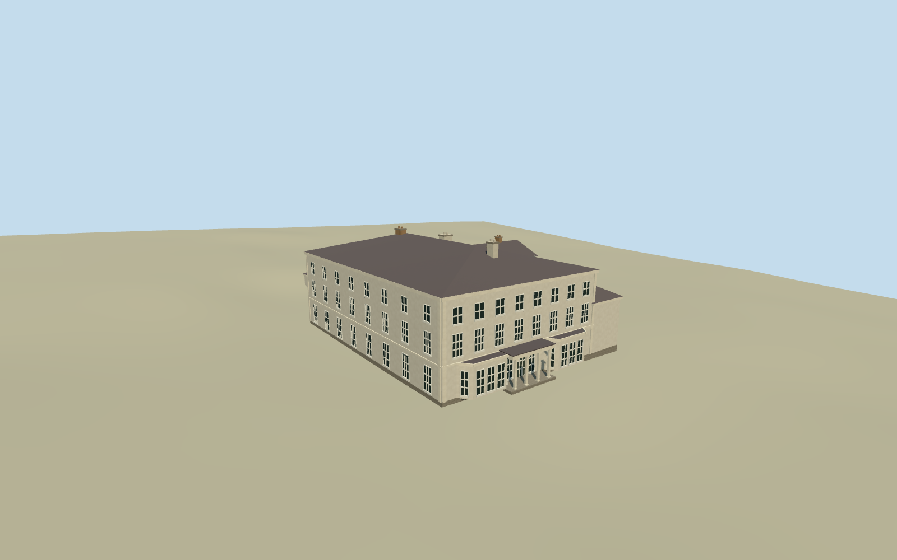

# Moreton House, Bideford

The rendered Georgian house at Bideford with its east portico and canted bays, south lawn front, and stepped northern service ranges.

Authoring state: **review-in-qa.json**. Current completion evidence is in [qa.json](qa.json) and the [completion ledger](../../../../qualla-structures/batches/qualla-004.PROGRESS.md).

- [Moreton House, Bideford](https://qualla.com/moreton-house-bideford/)

Exterior of the individually listed house and attached ranges. The separately listed former stables, gardens and interiors are outside scope.

The mapped outline and front and rear Qualla photos control the exterior; exact roof heights, concealed elements and small details are estimated.

Build: `node content/worldgen/source/places/gc/gch/moreton_house_bideford/models/generate-moreton-house-bideford.mjs`. Add `--check` to verify exact regeneration. 7204 triangles; 6 materials; no embedded photographs.
