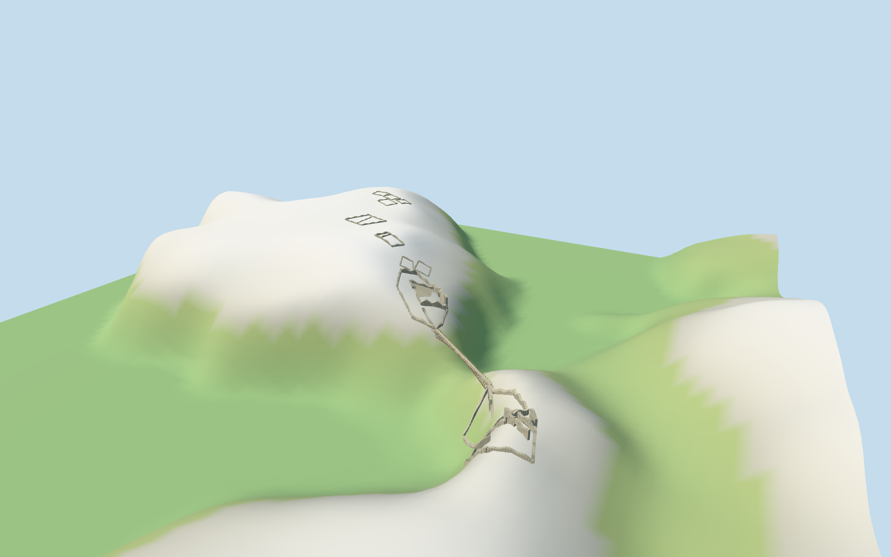

# Tintagel Castle

Surviving slate-stone island hall and open courtyard, separate mainland gatehouse/upper rooms, chapel and garden foundations, selected early low island rooms, and the narrow tapered modern footbridge on its mapped crossing.

## Evidence and reconstruction

Published dimensions and reconstructed details are separated in spec.json. Primary references:

- [Reference](https://www.english-heritage.org.uk/siteassets/home/visit/places-to-visit/tintagel-castle/school-visits/tintagel-header-image.jpg)
- [Reference](https://www.english-heritage.org.uk/siteassets/home/visit/places-to-visit/tintagel-castle/things-to-see-and-do/tintagel-ttsad-header.jpg)
- [Reference](https://cornwallprints.com/cdn/shop/files/TINTAGEL-SUM26-195.jpg?v=1787520120&width=1600)

Four canonical shared texture graphs supply wall stone, coarse paving, painted bridge chords and stainless lattice. No unique bitmap or embedded photograph.

## Model and axes

19,176 triangles; 57,528 vertices; 4 material groups; 2,304,072 bytes. Native bounds: -203.888, -11.571, -205.103 to 71.203, 55.842, 75.990. Source hash: `sha256:b62d8f2e4ab902fca8e832bc7d82bbc0c161debb5f3d60441ecfc92cb5cd27d1`.

{"x":"+X east","y":"+Y up","z":"+Z south"}

North-up bridge and named-site controls; current source terrain views inspected, with explicit approximate ground and architectural levels.

## Reproduce

Run `node packages/worldgen/scripts/generate-additional-landmarks.mjs --ids=N0311` (or add `--check`). The generator preserves manually edited masters by checking their baseline hashes. Import through the standard authored-model workflow with optimization disabled; then capture all QA cameras, including shared-surface views.

## Pending work

- Wall plans, ruin profiles, architectural elevations, bridge height and exact terrace contact are picture-led approximations against coarse standard viewer PMTiles; not surveyed geometry.
- Natural caves/cliff geology, buried/lost structures, Gallos sculpture, modern visitor facilities, vegetation and certified walkable collision are excluded. The master depicts surviving exterior remains, not the complete medieval castle.
- Physical laptop and phone frame-rate measurements remain pending.

This bundle follows the medium-fi standard. Medium-fi appearance and geographic fit are reviewed separately. Hash-bound visual acceptance is recorded separately after capture inspection.

## Additional geographic data

© OpenStreetMap contributors; Protomaps; Mapzen/USGS terrain tiles.
