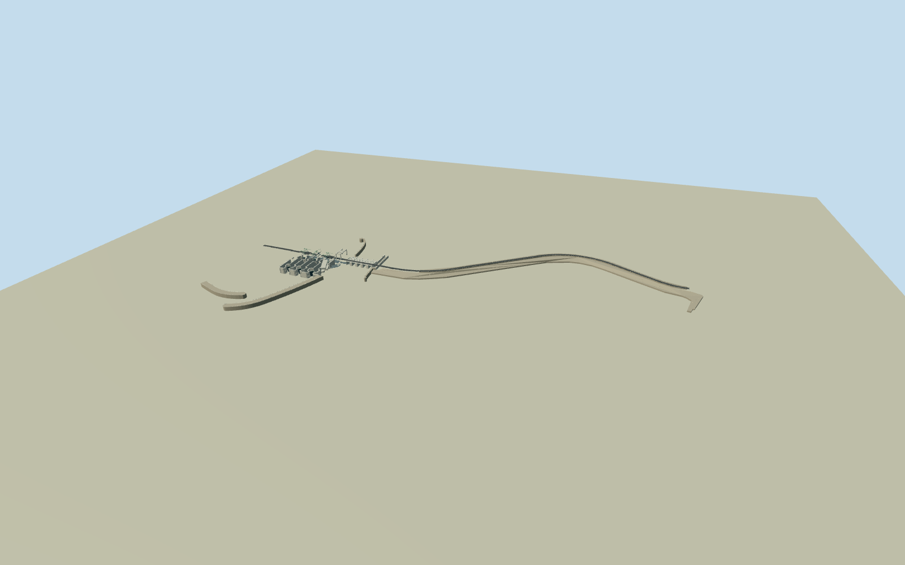

# Cardiff Bay Barrage

Complete mapped waterworks and curved engineered embankment:3open lock chambers/sector gates, pale green bascule arms/counterweights with middle bridge raised, genuine holed support frames, cantilevered glazed control room/open gantry,5sluice throats and separate fish-pass pools, bounded guide arms and angular laid-rock revetments/asphalt crest. No natural sea/landscape, neighboring dock locks, town, boats or lettering.

Authoring state: **review-in-qa.json**. Current completion evidence is in [qa.json](qa.json) and the [completion ledger](../../../../qualla-structures/batches/qualla-002.PROGRESS.md).

- [Cardiff Bay Barrage](https://qualla.com/cardiff-bay-barrage/)

Original native waterway=dam1287700755 and three named bascule bridge area ways1287683082/83/84 identify Cardiff Bay Barrage, with complete holed support multipolygons17649458/59/60, six sector-gate lines, original harbour-master control building90271495and holed gantry17649463. Full original individual vertices preserved. Extended curving crest road90311540and paired angular laid-rock revetment polygons389268997/998are the intrinsic artificial embankment. Native park parcels/coastlines are context only, never solid building meshes. Separate Alexandra Dock/Penarth Marina lock-gates are excluded.

Three exact supplemental own-workPD/CC0originals actually inspected after local Qualla-first74candidate coverage check. KevinPowellnative lock-entrance photograph has original named creatorPD-user-enrelease; two AugustDominus2024CC0photos control curved asphalt crest and laid-rock revetments. All exactSHA1matched and pinned creator releases bound; unrelated/other-licensed images unused. No photographic texture or generated bitmap.

The five sluice throats lie between native dam pier notches across local X77..139. Native small water rectangles at X105..140show only three named throat portions; areas at X144..152and Z-8..13are fish-pass/adjacent channel subdivisions, not extra sluice gates. Do not treat the six area records as six identical gates or punch only three main openings.

Original native component plans and individual near perimeter vertices retained. Nominal40musable chambers/8/8/10.5mclear widths and5gates9x7.5mcome from official harbour text, while sector-gate centre separations, wall thicknesses, waterline/footing levels, bridge-leaf angle/hinge subdivision and hidden section heights are photographic medium-fi estimates. Three gateways genuinely open, native support/gantry inner rings retained; middle leaf shown35degreesraised as a representative operating state.

Control room upper cantilever/continuous glazing and grey service podium follow inspected photograph, but exact hidden upper-floor partition/height and all fine machinery fittings are estimates. Original angular rock relief approximates engineered revetment stone scale/census. Wide park parcels, natural sea/cliff/mudflats, sailing/recreation buildings and separate AlexandraDock/PenarthMarina locks are excluded.

Unmodified independent1600mcoastal grid frozen before geometry, origin[-350,-800], step6.25,res257, fixed Penarth approach datum11m. Provider full grid contains offshore/deep-water artifacts down to-686.7588m; preserve originals, do not fit architecture to these samples or certify host sea/bed contact. Use approximate independent architectural deck/footing levels and flat inspection stage.

Dry approachY0/crestY1and lockfloorY-13are independent approximate architectural levels; flat inspection stageY-14shows the waterworks, without claiming certified tide/water/host terrain contact. FartherLODs simplify bounded native fine vertices within declared errors.

Build: `node packages/worldgen/scripts/generate-authored-places.mjs --ids=cardiff_bay_barrage`. Add `--check` to verify exact regeneration. 34523 triangles; 6 materials; no embedded photographs.
