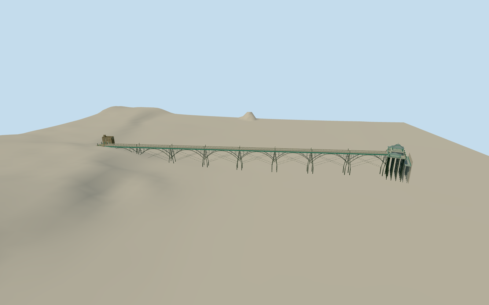

# Clevedon Pier

Selected2007–2013 slender iron pier: eight real open arched spans/radiating struts, paired raked trestles/ties, grey timber deck/continuous benches, teal side girders/globe lamps, angled column-supported head with two low glazed shelters and raised central pagoda/white balcony/external stair, open landing stairs/lower concrete stage and narrow castellated sandstone tollhouse. Neighboring hotel, later Glass Box and Bell Room infill excluded.

Authoring state: **review-in-qa.json**. Current completion evidence is in [qa.json](qa.json) and the [local 100 ledger](../../../../qualla-structures/batches/PROGRESS.md).

- [Clevedon Pier](https://qualla.com/clevedon-pier/)

New close white quatrefoil balcony tracery and rectangular perforated green crest plus street/close crossed iron span ties use four exact named Ownwork/PD-self/CC0originals,starting with two cleared local Qualla natives. Full fixed eight-span pier/head/pagoda/two shelters/landing/tollhouse scope retained. Exact ornament/counts,profile dimensions,hidden surfaces and current condition remain estimates; cleared tollhouse coverage still missing. Earlier attribution/private image controls are historical and excluded.

Selected2007–2013 exterior predates2016 Glass Box and later Bell Room infill. Eight equal estimated station intervals follow independent280.21m mapped neck; nominal published100ft spans/historical842ft dimensions conflict with mapped/story overall length. Exact chainages and elevations remain estimates.

All source images inspected as recorded; original approximate iron profiles/curved roofs/ornaments and unseen tollhouse walls/windows are not scans or construction drawings. Integral benches and lamps retained; tiny plaque marks have no copied names. No photographic pixels embedded.

Fixed landing/stair pose and pile depths are estimates, not tidal/structural engineering. Source independent terrain retained unchanged; native composite marine returns are not measured water surface or seabed. Current terrain contact requires separate visual review and host compatibility remains limited. Footprint replacement disabled.

Neighboring Royal Pier Hotel, shore Glass Box/streets/landscape/rock/sea/boats, temporary flags and visitors, nonintegral sculptures/furniture and interiors excluded.

Build: `node packages/worldgen/scripts/generate-authored-places.mjs --ids=clevedon_pier`. Add `--check` to verify exact regeneration. 63612 triangles; 7 materials; no embedded photographs.
