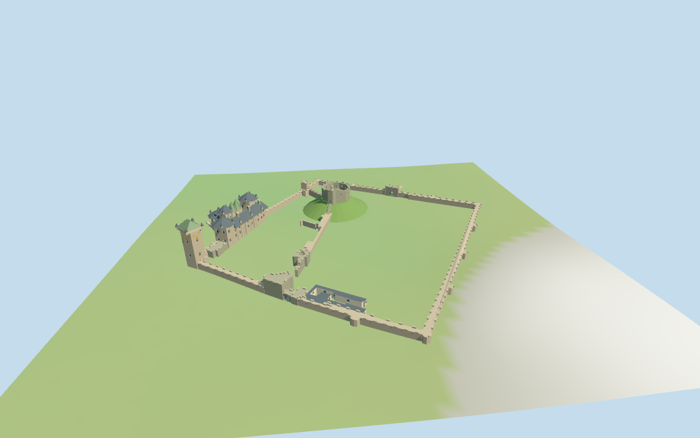

# Cardiff Castle

Individual enclosed Cardiff exterior: open faceted Norman keep with gate/turret, grassy motte and mapped stairs; western palace and unequal towers/roof pieces, southwest clock tower, outer and inner curtains, gate passages, named north/west bridge approaches and simplified visitor range.

## Evidence and reconstruction

Published dimensions and reconstructed details are separated in spec.json. Primary references:

- [Reference](https://www.cardiffcastle.com/visit/see-do/norman-keep/)
- [Reference](https://commons.wikimedia.org/wiki/File:Aerial_view_of_Cardiff_Castle.jpg)

Four existing 256-square graphs supply weathered limestone, slate, painted metal and lime plaster with metric UVs and linear tints. Glass, grass and clock accents use vertex colors. No unique photographed facade or embedded images.

## Model and axes

22,875 triangles; 68,625 vertices; 8 material groups; 2,749,476 bytes. Native bounds: -136.738, -2.055, -131.132 to 132.652, 39.500, 132.577. Source hash: `sha256:a7fced94f50f88756c16f674142b8ddfd44330039ba58daa6bfffedc33c7297e`.

{"x":"northwest along the mean of the two bridge approaches","y":"up","z":"northeast"}

Two inspected pictures and standard viewer PMTiles/DEM guide the enclosed castle exterior. Component heights, roof profiles, ornament and motte are estimates. City, trees, exact sculptures and interiors remain host content. © OpenStreetMap contributors, ODbL-1.0.

## Reproduce

Run `node packages/worldgen/scripts/generate-additional-landmarks.mjs --ids=N0325` (or add `--check`). The generator preserves manually edited masters by checking their baseline hashes. Import through the standard authored-model workflow with optimization disabled; then capture all QA cameras, including shared-surface views.

## Pending work

- Mapped castle/site/keep courtyard and24selected component polygons control the exterior. Component roles, wall/window arrangement, roof/gable/turret profiles and untagged heights are approximate picture-led interpretations.
- NativeY0 follows standardDEM12.8751m; the small motte is not represented in that DEM and uses an approximate10.8m plateau. Palace2.8m floor, moat/terrace levels, stairs, foundations and bridge/terrain joins are approximate, not surveyed or certified walking collision.
- Skyline keeps open keep/motte, simplified palace/tower/roof silhouette, clock and enclosure, omitting the modern visitor range and ornament. District adds sparse surface windows, crenellations, clocks and bridge rails. Street restores a single recessed facade row, slits, stair treads, chimneys and selected clock accents; closeup restores both facade rows and denser crenellations/trim. Full interiors, underground shelters, exact sculpture, heraldry, clock lettering and weathering are excluded.
- City, trees, visitors, exact animal wall sculptures and full gardens remain host content. Physical laptop and phone performance measurements remain pending.

This bundle follows the medium-fi standard. Medium-fi appearance and geographic fit are reviewed separately. Hash-bound visual acceptance is recorded separately after capture inspection.

## Additional geographic data

© OpenStreetMap contributors; Protomaps; Mapzen/USGS terrain tiles.
