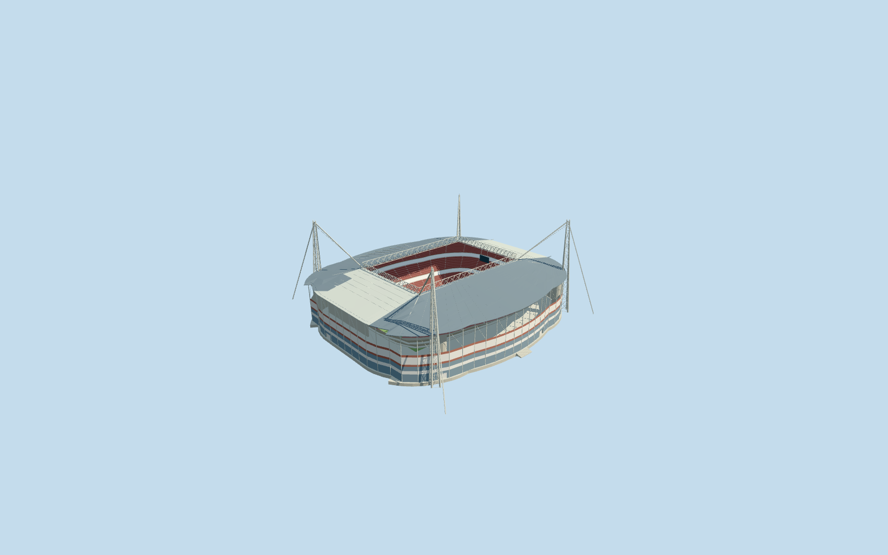
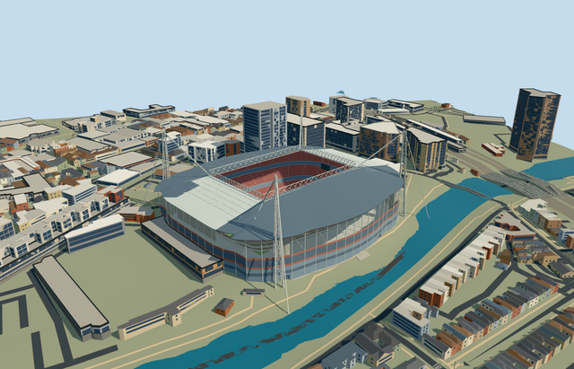

# N0711 — Millennium Stadium

Reviewed 2026-10-20 in one continuous author/build/inspect/fix round.

## Appearance

Inspected48 current portable/shared/medium-fi/native-site frames in one ordinary-picture/map/build/inspect/fix pass. Specific rounded stadium with rectangular open roof aperture, closed dark fixed side roofs/renderable undersides and pale parked retractable end panels, two deep longitudinal triangular girders/end lattice, four tapered open mast frames/paired pointed heads/bracing/continuous stays, muted red three-tier bowl with lower two-tier north stand/corner gaps, neutral rugby floor/linework/H-goals, supported end displays, blue/red curved glazed facade/exposed upper frame, stair-service cores and recessed closed entry groups. Continuous risers/tier fronts, capped north-gap ends, attached upper columns/rafters and end-display brackets corrected during construction. Source-only portable views intentionally expose the full support volume without terrain. Shared/medium-fi fixtures use the bounded opening; native fixture proves original map/grade/river fit. No visible duplicate native stadium shell in successful levels.

## Shared materials and browser levels

Five existing shared256-square graphs: concrete_plain, metal_painted, metal_standing_seam, window_grid and fabric_canvas. Concrete supplies frame/tiers/support floor/cores/steps; tinted paint supplies structure/seats/markings/goals/neutral displays; standing-seam finish approximates fixed and parked roof panels; window-grid supplies closed glazing; canvas grain explicitly approximates turf. Six near-level material draws, each nearby graph read once, eviction releases geometry. Six actual GLBs have zero embedded images/copied pixels, canonical shared refs, separate runtime POSITION/NORMAL streams and equal counted CPU/GPU geometry bytes. No unique bitmap texture/building photo atlas.

| Level | Triangles | Bytes | Draws |
| --- | ---: | ---: | ---: |
| skyline | 904 | 91204 | 1 |
| district | 3942 | 388012 | 5 |
| street | 15362 | 1433468 | 5 |
| closeup | 36638 | 3329900 | 5 |

Inspected24 final medium-fi views at street/block/skyline distances, noon/late afternoon, Economy/High, neutral silhouette, matched levels and transitions. Skyline retains the rounded body/open-roof silhouette, pale parked panels, bowl/floor closure, four mast frames/stays and main roof girders; district adds facade bands/glazing/tier arrangement/field lines/goals; street/closeup add restrained rows/aisles, lattice/roof structure, entry and service-core detail. Initial skyline plus district479216bytes. Synthetic neighbors establish appearance only; physical ordinary-laptop/phone and dense-city timings remain pending. Levels904/3942/15362/36638 triangles; at most six draws.

## Approximate map fit

Retained exact-QID OSMway1287329038/leisure outline identifies Q204496 (Millennium/Principality Stadium). Own anchor-3.182592872,51.478226141/global heading0/native east-south. Native226.848x199.307m body, internal angle-1.118958601154rad and actual mapped roof aperture fix fit/orientation independently of older reference-3.1825,51.478055555. Six roof/facade and four projected mast records establish compound ownership. All1120 independent resident inputs among1130 originals (1755 wider records), original6m terrain samples/native roads and142424.30092292748m2 Taff water remain unchanged, including separate Arms Park. Five hole-preserving replacement polygons protect seven overlapping independent footprints plus25mm halo. Loaded1127 records include seven owned fragments, totaling23.764324856248038m2 retained beneath those protected footprints/halo; numerical exterior residue is at most2.872935448294811e-05m2 per owner (below1cm2), explicitly not zero residual. Actual loaded owner areas match original-minus-mask within1e-7m2. No visible old stadium shell. A bounded opening within95percent of the body is clipped25mm inside the common supported floor of all four levels to remove coarse DEM intrusion beneath the closed authored stadium floor. Original source samples, outside ground and all river geometry remain intact. Success alone activates the opening; failure keeps original ground/1130 buildings. All four levels unload with restored ground/water and zero live model geometry. No Arms Park/office/riverwall or whole-site platform is modeled.

## Limits

Original medium-fi exterior and selected visible bowl/roof detail follow five actually viewed ordinary pictures dated2005/2007/2008(page date; embedded EXIF2014 conflicts)/2010/2014. Later equipment/finish changes are unverified. No qualified heights: retained33m/222x181m values are unqualified and mapped plan controls; mast90.3m is an unverified picture-caption allocation. Facade33m, seating1.4..10/14..23/27..36m, roof40..50m/girders49..56m and fine row/entry/brace/stay inventory remain picture-led estimates with20degree/2m facing uncertainty. Raw anchor sample20.3025497733m/relative floor-9.5323587249m, actual field+.3m, native perimeter range-11.5989..-1.3334m; bounded opening handles coarse terrain intrusion and is not a surveyed real excavation. Each mast foot samples its own native grade. Static open-roof configuration only: no animated or certified retracting mechanism. Neutral120x70m rugby floor/100m goal-line separation represents a standard sport configuration, not an as-built pitch certification. Shared standing-seam finish and canvas grain approximate roof/turf. No copied sponsor/live-screen text/photographic atlas, crowd/concert equipment, furnished service interior, independent Arms Park stand/field or whole-site reconstruction. Terrain contacts are not surveyed foundations/drainage/flood measurements.

## Selected checks

Six Khronos files: zero errors/warnings.1413 actual mesh/material/contact checks; 48 current inspected views. Scene validation/sim30 and strict selected medium-fi audit pass. Source/runtime/LOD hashes and material bindings verified.

Rebuild: node packages/worldgen/scripts/generate-additional-landmarks.mjs --ids=N0711; node packages/worldgen/scripts/import-next-1000-models.mjs --ids=N0711; node packages/tooling/scripts/generate-landmark-lods.mjs --ids=N0711 --force.

Source: sha256:fdf3e2d6b538f1df6f4241966e25019bedb1d11f1cb6ba3757af12184da81ed8

Runtime: sha256:6384c6372ad9ad0aaa6215b2e2ac98e121ffacc22b61f40ec227605611cc71aa

Input: sha256:d331ac431f5e71cb6dacee972c932fa5f5d920455167ba6a07aa76a2dafe499a

## Viewed ordinary pictures

https://commons.wikimedia.org/wiki/File:Millennium_Stadium_(aerial_view).jpg — Clint Budd; CC-BY-2.0. Viewed only; no pixels copied.

https://commons.wikimedia.org/wiki/File:Principality_Stadium,_Cardiff_from_River_Taff,_8.14.jpg — G-13114; CC-BY-SA-4.0. Viewed only; no pixels copied.

https://commons.wikimedia.org/wiki/File:Millennium_Stadium.jpg — Peter Morgan / Mooganic; CC-BY-2.0. Viewed only; no pixels copied.

https://commons.wikimedia.org/wiki/File:Inside_the_Millennium_Stadium_-_geograph.org.uk_-_1939955.jpg — Philip Halling; CC-BY-SA-2.0. Viewed only; no pixels copied.

https://commons.wikimedia.org/wiki/File:Glanmor's_Gap,_North_Stand,_Millennium_Stadium.jpg — al_green / Alan; CC-BY-SA-2.0. Viewed only; no pixels copied.
