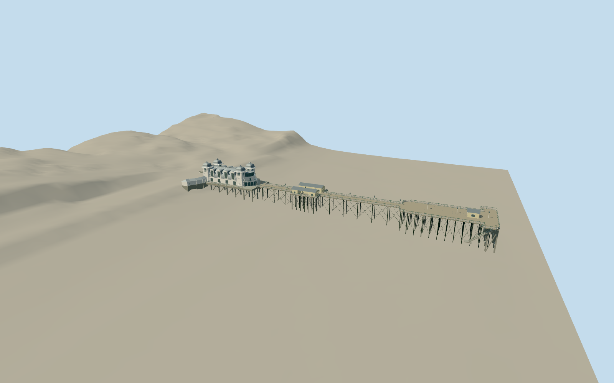

# Penarth Pier

Restored white concrete shore pavilion with four silver square Moghul domes/finials and diamond grilles, zinc barrel roof/four tall dormer windows per side/11 ribs/ridge vents, curved seaward glass colonnade/two terraces/upper observatory, convex landward lobby/low curving shop wings and projecting clock. Complete surviving timber deck on iron neck piles/concrete end frames, white/green traceried railings/lamps, two open-porch shelters, broad open head/ticket hut and landing edge. Lost1931 theatre and neighboring promenade buildings excluded.

Authoring state: **review-in-qa.json**. Current completion evidence is in [qa.json](qa.json) and the [local 100 ledger](../../../../qualla-structures/batches/PROGRESS.md).

- [Penarth Pier](https://qualla.com/penarth-pier/)

Mapped shelter footprints extend up to1.3m past the generalized landuse deck ring. Four authored bulge-edge vertices are explicitly widened to retain porch floors/outer rails; original map ring is preserved. Shore-wing foundations extend to fixed-8m and marine supports to-15.5m beneath reviewed grade; hidden foundations and embedment are visual estimates.

Selected post2013 restored exterior. Closed close-level white cast-metal fan panels have four original simplified open counters each and green framing, interpreted from the exact cleared Qualla2024native; casting profile/counts are not a survey. Broader roof curves, scale seams, lattice, heights, hidden walls, support spacing and finials remain estimates. Cleared full-pavilion/support imagery is still required for whole-model fidelity; full fixed exterior scope is retained.

Main body about35x17m/shore wings46m; full envelope193m agrees broadly with primary about200m. Current mapped broad head28m differs legacy15m landing-stage description. Native outline retained; exact original chainages/alteration history not inferred.

Independent1m Welsh DTM is unchanged; source interpolation under roof/deck is not survey certainty or seabed/tide measurement. Fixed supports/landing poses and host terrain compatibility remain approximate. Bounded geographic preview requires current review; footprint replacement disabled.

No lost seaward wooden theatre, neighboring apartments/baths/promende buildings, separate K6 kiosk, beach/sea/boats, people/temporary signs/flags/string lights, loose furniture or interiors. Clock marks are original simplified glyphs without copied brand text. No source pixels embedded.

Build: `node packages/worldgen/scripts/generate-authored-places.mjs --ids=penarth_pier`. Add `--check` to verify exact regeneration. 63574 triangles; 7 materials; no embedded photographs.
