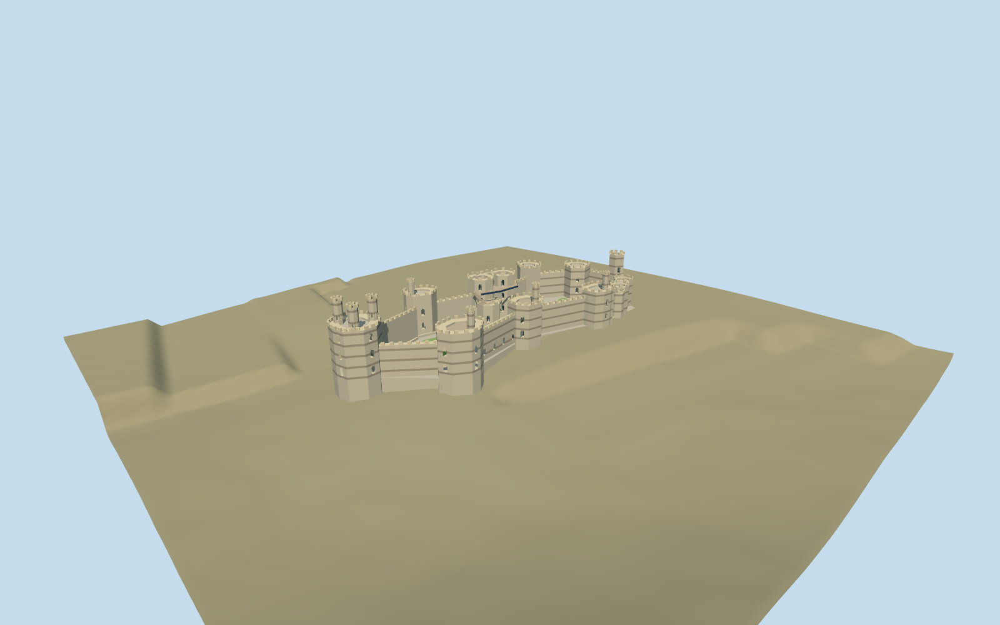

# Caernarfon Castle

Present-day Caernarfon: nine polygonal towers, three Eagle turrets, grey/warm banded river walls, two open wards, raised Queen's Gate and restored timber King's Gate decks.

## Evidence and reconstruction

Published dimensions and reconstructed details are separated in spec.json. Primary references:

- [Reference](https://cadw.gov.wales/visit/places-to-visit/castell-caernarfon)
- [Reference](https://cadw.gov.wales/more-about-castell-caernarfon)
- [Reference](https://cadwpublic-api.azurewebsites.net/reports/listedbuilding/FullReport?id=3814)
- [Reference](https://cadwpublic-api.azurewebsites.net/reports/sam/FullReport?id=3417&lang=en)
- [Reference](https://commons.wikimedia.org/wiki/File:Caernarfon_Castle_plan_labelled.png)
- [Reference](https://buttress.net/projects/caernarfon-castle-gatehouse)
- [Reference](https://buttress.net/journal/2023/08/30/detail-upper-deck-seating-caernarfon-castle)
- [Reference](https://www.openstreetmap.org/way/70264991)

No third-party geometry, photograph or bitmap texture is embedded. Shared surface graphs come from the central library; vertex tints carry model colors. Glazing uses PBR materials; transparent surfaces are declared per model.

## Model and axes

16,236 triangles; 48,708 vertices; 5 material groups; 1,951,492 bytes. Native bounds: -87.541, -7.921, -32.945 to 87.368, 35.800, 33.038. Source hash: `sha256:1bd0a76124e8e0a63620cbbb71652c21734416cb836880400efc0d57e224f317`.

{"up":"+Y","longitudinal":"+X east-northeast,10.88 degrees north of east","front":"-Z town-facing King's Gate; +Z Seiont river curtain","origin":"Site anchor; Y0 standard PMTiles working datum."}

The inspected aerial picture confirms polygonal towers, three Eagle turrets, banded river curtain and two open wards. Standard viewer PMTiles and the retained castle outline set location, scale and orientation. A reconstructed0.8m working rise clears the coarse eastern ground; bounded foundations continue below the sampled riverside slope. Anchor -4.277013785,53.139327542; heading 0.189928481827; standard PMTiles datum 12.786984754537153m. Floors are reconstructed and foundations extend below the coarse sampled ground.

## Reproduce

Run `node packages/worldgen/scripts/generate-signature-towers.mjs --ids=N0273` (or add `--check`). The generator preserves manually edited masters by checking their baseline hashes. Import through the standard authored-model workflow with optimization disabled; then capture all QA cameras, including shared-surface views.

## Pending work

- Picture and standard viewer PMTiles establish approximate exterior fit; no bespoke survey or exact threshold measurements.
- The original detailed architectural recipe and master hash remain preserved. An independent runtime derivative adjusts working height and bounded foundations.
- Polygonal towers, Eagle turrets, banded walls, open wards, raised eastern gate and restored timber gate decks define identity. Fine carving and openings remain reconstructed.
- The model covers the castle exterior and visible gate decks. Town, harbor, retaining landscape and navigable interiors are outside its scope; no artificial terrain cutout.
- Three shared material graphs, local opaque glass and grass color; no embedded images. Physical-device timing remains pending.

This bundle follows the medium-fi standard. Medium-fi appearance and geographic fit are reviewed separately. Hash-bound visual acceptance is recorded separately after capture inspection.

## Additional geographic data

© OpenStreetMap contributors, ODbL-1.0. Cadw plan: Crown copyright, Open Government Licence v1.0. Operator and Buttress photographs used as visual references only.
