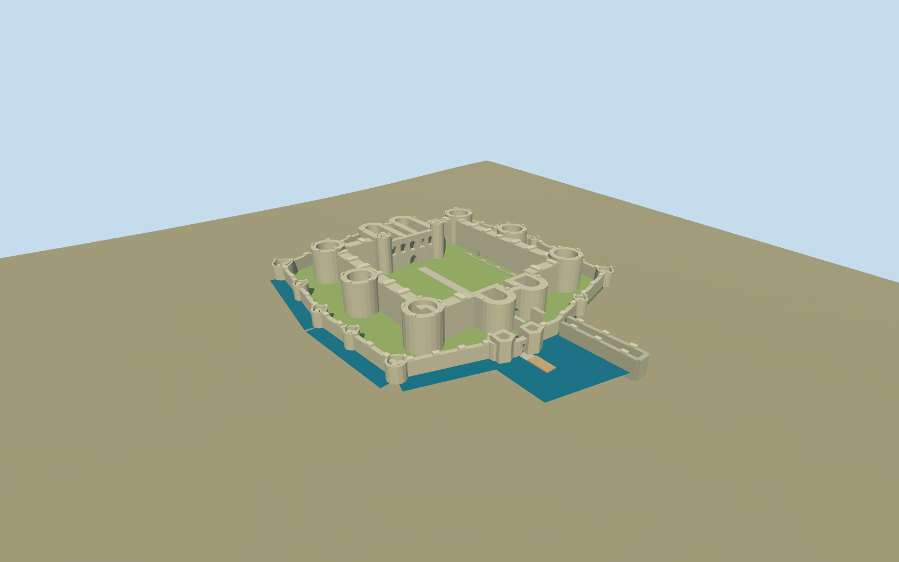

# Beaumaris Castle

Present-day roofless concentric castle:six squat inner towers,twin-D gatehouses,five north-hall openings,lower outer tower circuit,offset sea gate,low unfinished foundations and moat/dock study.

## Evidence and reconstruction

Published dimensions and reconstructed details are separated in spec.json. Primary references:

- [Reference](https://cadw.gov.wales/visit/places-to-visit/beaumaris-castle?lang=en)
- [Reference](https://cadw.gov.wales/media/1099)
- [Reference](https://cadw.gov.wales/beaumaris-castle-access-guide)
- [Reference](https://www.openstreetmap.org/way/48296427)

No third-party geometry, photograph or bitmap texture is embedded. Shared surface graphs come from the central library; vertex tints carry model colors. Glazing uses PBR materials; transparent surfaces are declared per model.

## Model and axes

6,071 triangles; 18,213 vertices; 4 material groups; 731,364 bytes. Native bounds: -59.973, -2.160, -77.918 to 56.527, 19.200, 72.900. Source hash: `sha256:c7dfda06edfd13c6729ae8f422b60a2f3e877a8c1adb50ee8e5f4f2ad5b4ae50`.

{"up":"+Y","longitudinal":"+Z toward the sea gate and dock","lateral":"+X across the inner ward toward the chapel tower","origin":"Site anchor; Y0 standard PMTiles working datum."}

The inspected aerial picture confirms roofless concentric wards, six squat inner towers, twin-D gatehouses, lower outer circuit and partial moat. Standard viewer PMTiles and the retained outline set approximate location, scale and sea-gate/dock orientation. A reconstructed1.6m working rise clears coarse ground around the castle; bounded wall/tower bottoms extend beneath sampled terrain. Moat/dock blue surfaces remain an approximate visual interpretation, with no terrain cutout or water simulation. Anchor -4.089706701,53.26470434; heading 0.26314714676; standard PMTiles datum 7.4077225530211805m. Floors are reconstructed and foundations extend below the coarse sampled ground.

## Reproduce

Run `node packages/worldgen/scripts/generate-signature-towers.mjs --ids=beaumaris_castle` (or add `--check`). The generator preserves manually edited masters by checking their baseline hashes. Import through the standard authored-model workflow with optimization disabled; then capture all QA cameras, including shared-surface views.

## Pending work

- Approximate current exterior from inspected picture and standard viewer PMTiles; no bespoke survey or exact thresholds.
- Original detailed architectural master/recipe preserved; derivative fits working wards and bounded foundations.
- Roofless squat towers, twin-D gatehouses, five north-hall openings, lower outer ring, sea gate and low unfinished foundations retain identity. Fine openings and wall/tower dimensions reconstructed.
- Moat is an approximate opaque surface on partial strips and dock study; no exact present waterline or engine water simulation, no terrain cutout. Eastern former moat stays dry.
- Lost roofs/unbuilt stories, coast/town walls, demolished mill, trees, visitor center, modern fixtures and interiors excluded. Footprint replacement stays off.
- Three common material graphs and local grass/water color slot; zero embedded images. Physical-device timing pending.

This bundle follows the medium-fi standard. Medium-fi appearance and geographic fit are reviewed separately. Hash-bound visual acceptance is recorded separately after capture inspection.

## Additional geographic data

© OpenStreetMap contributors;Cadw,Welsh Government architectural references.
