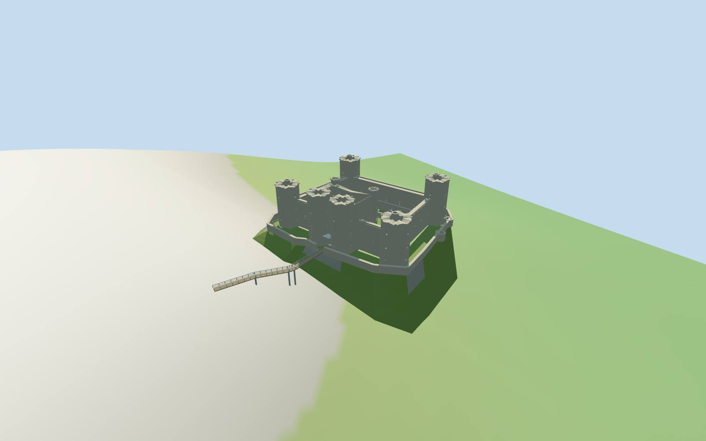

# Harlech Castle

Individual roofless Harlech Castle: four hollow corner drums, twin projecting gate towers, two rear stair turrets, high rectangular inner curtains, lower concentric walls and small rounded projections. The gatehouse retains large true window voids and a clear central passage; grassy courtyard, low domestic ruins, rocky crag and the actual curved modern approach bridge remain distinct.

## Evidence and reconstruction

Published dimensions and reconstructed details are separated in spec.json. Primary references:

- [Reference](https://www.aerialviews.org/photos/Harlech_Castle_in_Gwynedd.jpg)
- [Reference](https://dda-engineers.co.uk/application/files/7915/9948/3455/H_C8.jpg)

Five existing canonical256-square graphs supply rubble stone, crag granite, wood decking, painted bridge metal and the small metal entrance canopy. Lawn is a plain vertex color. Metric UVs and linear tints; no unique bitmap or embedded photograph.

## Model and axes

15,484 triangles; 46,452 vertices; 6 material groups; 1,861,836 bytes. Native bounds: -48.028, -14.515, -50.294 to 74.715, 42.579, 52.515. Source hash: `sha256:87330f5cea9c40ae417765af0ee60336d9838e0865128dc45c39adffbac966c2`.

{"x":"castle-to-visitor chord of the mapped modern footbridge","y":"up","z":"perpendicular to approach"}

Standard viewer castle polygon with courtyard and tower-well holes, exact-QID retained way117407449 and actual bridge LineString control approximate scale and signed facing.

## Reproduce

Run `node packages/worldgen/scripts/generate-additional-landmarks.mjs --ids=harlech_castle` (or add `--check`). The generator preserves manually edited masters by checking their baseline hashes. Import through the standard authored-model workflow with optimization disabled; then capture all QA cameras, including shared-surface views.

## Pending work

- Wall heights/thicknesses, ruin profiles, room partitions and outer curtain projections are picture-led approximations, not a measured conservation model.
- Modern entrance canopy is a simplified light metal covering; exact glazing, bridge truss/support engineering, furnishings and certified walkable collision are excluded.
- The standard viewer DEM blends the castle crag. Authored plateau/rock skirt and deck elevations are approximate; no runtime terrain carving or surveyed ground/approach contact is claimed.
- Physical laptop and phone frame-rate measurements remain pending.

This bundle follows the medium-fi standard. Medium-fi appearance and geographic fit are reviewed separately. Hash-bound visual acceptance is recorded separately after capture inspection.

## Additional geographic data

© OpenStreetMap contributors; Protomaps; Mapzen/USGS terrain tiles.
