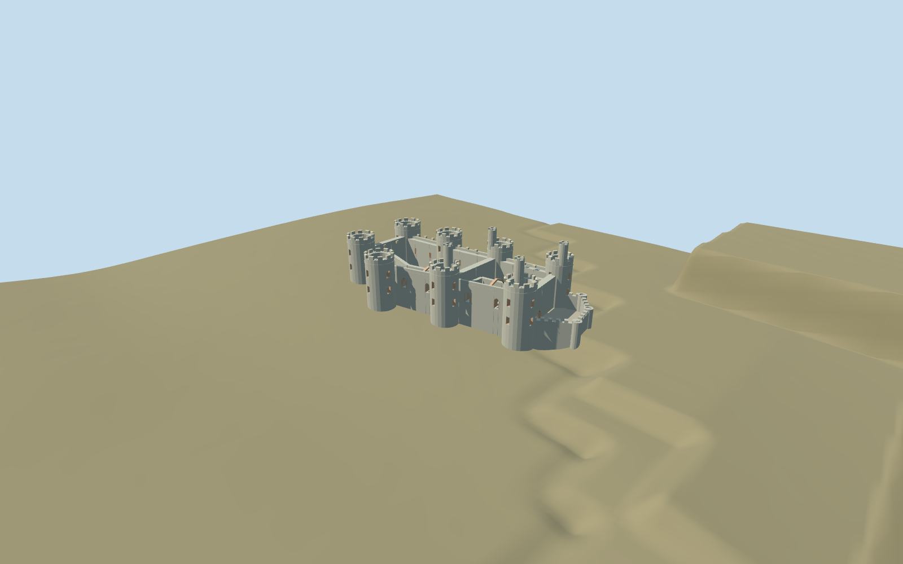

# Conwy Castle

Present-day roofless Conwy Castle: eight open round towers, four tall inner-ward stair turrets, bent south hall range, paired open wards and low end barbicans.

## Evidence and reconstruction

Published dimensions and reconstructed details are separated in spec.json. Primary references:

- [Reference](https://cadw.gov.wales/visit/places-to-visit/castell-conwy)
- [Reference](https://cadwpublic-api.azurewebsites.net/reports/listedbuilding/FullReport?id=3250)
- [Reference](https://cadwpublic-api.azurewebsites.net/reports/sam/FullReport?id=3411&lang=en)
- [Reference](https://commons.wikimedia.org/wiki/File:Conwy_Castle_plan.jpg)
- [Reference](https://cadw.gov.wales/more-about-castell-conwy)
- [Reference](https://www.openstreetmap.org/way/52467063)

No third-party geometry, photograph or bitmap texture is embedded. Shared surface graphs come from the central library; vertex tints carry model colors. Glazing uses PBR materials; transparent surfaces are declared per model.

## Model and axes

11,944 triangles; 35,832 vertices; 5 material groups; 1,436,532 bytes. Native bounds: -60.800, -4.866, -29.480 to 60.800, 31.500, 29.480. Source hash: `sha256:844e6ad1da5e7737d2cee1a73060a33471719adcdc1294f5490c8d83a95585a8`.

{"up":"+Y","longitudinal":"+X east, about 4.26 degrees north of east","front":"+X river barbican; -X western town entrance","origin":"Site anchor; Y0 standard PMTiles working datum."}

Two overhead pictures confirm eight open round towers, paired roofless wards and the bent south hall. Standard viewer PMTiles and the cached exact castle outline set placement and east-west orientation. Court3.5m above the working sample clears the coarse rock surface; western town entry and eastern river barbican remain approximate. Anchor -3.82555084,53.280022417; heading 0.07442147105; standard PMTiles datum 8.781932169860132m. Floors are reconstructed and foundations extend below the coarse sampled ground.

## Reproduce

Run `node packages/worldgen/scripts/generate-signature-towers.mjs --ids=N0270` (or add `--check`). The generator preserves manually edited masters by checking their baseline hashes. Import through the standard authored-model workflow with optimization disabled; then capture all QA cameras, including shared-surface views.

## Pending work

- Picture and standard PMTiles fit, not surveyed geometry or thresholds.
- Detailed original Conwy geometry and recipe remain preserved. The independent derivative adjusts working datum and bounded foundation contact.
- Eight open towers, four stair turrets, paired roofless wards and bent hall range provide identity. Openings, copings, wall scars, platforms and internal partitions remain approximate.
- Coarse terrain does not resolve exact rock contact or approaches. No artificial hill, terrain cutout, navigable interiors, town walls or adjacent bridges are included.
- Four common material graphs and local foliage tint; no embedded texture images. Physical-device timing and continuous-motion shimmer remain pending.

This bundle follows the medium-fi standard. Medium-fi appearance and geographic fit are reviewed separately. Hash-bound visual acceptance is recorded separately after capture inspection.

## Additional geographic data

© OpenStreetMap contributors, ODbL-1.0. Cadw plan: Crown copyright, Open Government Licence v1.0. Current Cadw photographs used as visual references only.
