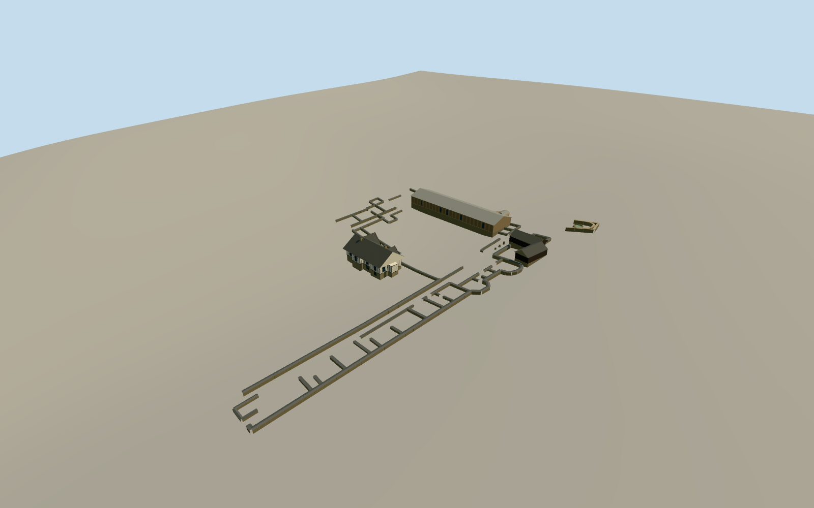

# Chedworth Roman Villa

Chedworth Roman Villa’s surviving courtyard walls, bathhouse and West Range shelters, octagonal spring shrine, and Victorian half-timbered lodge and museum.

Authoring state: **review-in-qa.json**. Current completion evidence is in [qa.json](qa.json) and the [completion ledger](../../../../qualla-structures/batches/qualla-003.PROGRESS.md).

- [Chedworth Roman Villa](https://qualla.com/chedworth-roman-villa/)

This is the surviving site, with exposed foundations, standing shelters, and the Victorian lodge and museum. The Roman superstructure and interior mosaics have no rendered reconstruction.

The open Roman wall lines, octagonal spring basin and standing buildings use native map geometry. Wall heights, roof sections, floor levels, stone capping and fenestration are estimates. The modern shelter is generalized from its mapped footprint and written project facts.

The regional DEM anchors the site and the natural slope. Models of the wall and basin courses sit above this independent field. The adjoining reception, learning pavilion, gardens and buried archaeology remain outside the model.

Build: `node content/worldgen/source/places/gc/gcn/chedworth_roman_villa/models/generate-chedworth-roman-villa.mjs`. Add `--check` to verify exact regeneration. 4368 triangles; 8 materials; no embedded photographs.
