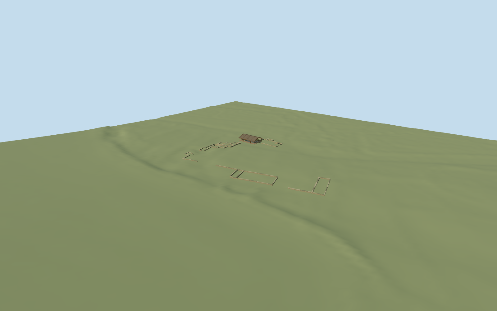

# Littlecote Roman Villa

Littlecote’s named archaeological enclosure, surviving rubble wall lines and open timber conservation canopy with the Orpheus pavement.

Authoring state: **review-in-qa.json**. Current completion evidence is in [qa.json](qa.json) and the [completion ledger](../../../../qualla-structures/batches/qualla-003.PROGRESS.md).

- [Littlecote Roman Villa](https://qualla.com/littlecote-roman-villa/)

The model depicts excavated remains and the current shelter. Wall courses, individual stone shapes, short unmapped edge sections, deck levels, rail details and shingle tones are approximate.

The triconch room uses the reported scale with a simplified geometric representation of the pavement field. Fine animal and human figures and the missing or repaired tesserae are outside the model.

The surviving site is modeled at the original grade. The exterior does not recreate buried walls, a Roman-era superstructure or the separately addressed Littlecote House.

Build: `node content/worldgen/source/places/gc/gcn/littlecote_roman_villa/models/generate-littlecote-roman-villa.mjs`. Add `--check` to verify exact regeneration. 9168 triangles; 6 materials; no embedded photographs.
