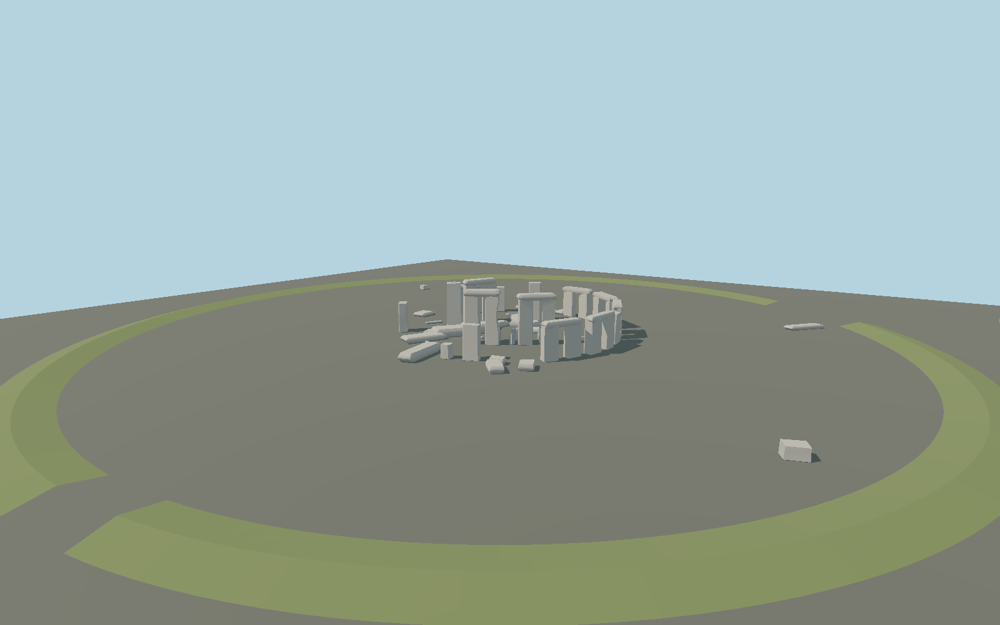

# Stonehenge — N0946

Complete static medium-fi interpretation of the current surviving Stonehenge ensemble: seventeen outer sarsen uprights including the short fragment, six surviving outer lintels, three complete inner trilithons, two isolated inner uprights, fallen sarsen fragments, visible bluestones and stumps, a mostly obscured Altar Stone, Heel Stone, Slaughter Stone, both surviving Station Stones and low bank/ditch earthwork surface. Missing ancient stones and lintels are not reconstructed. Layout and condition were read from the current English Heritage2015 plan; above-ground profiles, heights, local tilts, fragmentation and joint dimensions are authored photographic interpretations, not survey meshes or exact stone-number identification. The first draft recipe remains unchanged and independently reproducible. Four browser levels retain every authored stone and the bank; chamfering and surface tessellation increase toward closeup. A shared sandstone graph stands in for sarsen silicified sandstone, and common raw basalt stands in for mixed bluestone geology. Lichen, carvings, graffiti and particular mineral grains are not copied. Plan controls and raw OSM stone outlines disagree locally because generalized aerial top outlines are not ground surveys; four distinct outlying stones constrain a rigid fit with no scale change. Registration tolerance5m/2° acknowledges this. Bank height and ditch depth are relative interpretations; the runtime host supplies absolute terrain and its slope may occlude or expose the setting. Below-ground sockets, buried fragments, excavation markers, fences, access paths, full Avenue, visitor center and the wider World Heritage Site are outside the exposed stone-and-earthwork asset. Physical phone/laptop timing is unmeasured.

Source geometry: `packages/worldgen/scripts/stonehenge-detail-model.mjs`. The original draft builder remains unchanged in `generate-next-1000-models.mjs`; its exact historical bytes are tested independently. All current models and four browser levels are rebuilt from checked-in recipes. No copied survey mesh, private image or embedded texture.

Shared surfaces: matgraph:molen.worldgen.material.stone_basalt_raw, matgraph:molen.worldgen.material.stone_sandstone_raw. Signed placement, references and accepted limits live in `map-frame.json`, `reference-metadata.json`, `review-scope.json` and [QA review](QA-REVIEW.md).

Rebuild only this item with `node packages/worldgen/scripts/generate-next-1000-models.mjs --ids=N0946`; import using the same ID and regenerate its browser levels. GLBs are build outputs.
