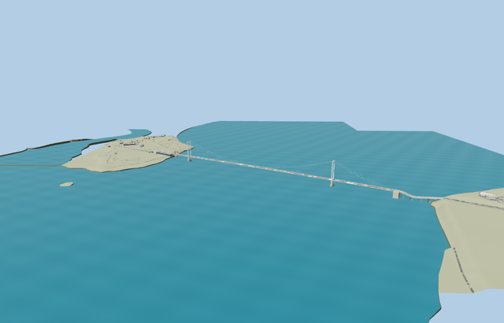

# Severn Bridge — completed current medium-fi pass

Reviewed 2026-10-25. **Complete scoped suspension/anchorage exterior and approximate native placement. Detailed source master preserved.**

## Geometry and shared materials

Inspected 63 current frames during one author/inspect/fix pass: 12 portable, 12 shared, 28 medium-fi and 11 native. Paired white portal towers, continuous main cables with exact saddle knots, inclined hangers, full shallow aerofoil deck and separate footways, piers and anchorages remain. Automatic near reductions had fragmented rails/cables; street and closeup now use independent analytic structural geometry with the complete 344-hanger schedule and continuous rails. Distant anchorage bases were lowered beneath the road, retaining separate side cable blocks and an open outer walking route. The 308648-triangle detailed shared-material source and canonical runtime master remain byte-exact.

Two existing 256px shared graphs, metal_painted and concrete_plain, supply painted steel and low-frequency aggregate. Metric UVs and restrained source paint/road tints; no embedded images, private atlas or copied photographic pixels. Three textured material groups/draws share these two graph resources, read once each; skyline bakes shared means into vertex colors in one draw. Separate GPU attribute streams and complete model geometry disposal pass. Source parapet pickets retain their fine original rhythm; runtime levels choose explicitly spaced rails/pickets instead of noisy decimation.

| Level | Triangles | Bytes | Draws |
| --- | ---: | ---: | ---: |
| skyline | 994 | 82804 | 1 |
| district | 3952 | 354180 | 3 |
| street | 14792 | 1089632 | 3 |
| closeup | 53752 | 4103664 | 3 |

Four complete authored LODs: 994/3952/14792/53752 triangles; initial skyline + district 436984 bytes. Closeup is 4103664 bytes. Skyline/district use representative paired hangers; near levels retain the full hanger schedule and source portal shapes. Street pickets are spaced 16m, closeup 2m, detailed master 0.75m. Economy/high, noon/late, near/far, silhouette and four transitions inspected under the shared Earth rig. Geometry/download budgets pass; physical laptop/phone timings remain pending.

## Native placement

Approximate native fit approved at [-2.6399325393140316,51.609817360632036], heading -0.5492121314969372, with +X toward Aust (east/southeast). Original M48 crossing Q1850537; not the second Severn crossing. Retains 987.5m main span, 305m side spans and 1597.5m suspended road. Simplified anchorage exteriors extend to 1637.5m. Local Y=0 is an approximate sea-plane reference, not a reconciled tidal/survey datum. All four mapped carriageway joins at x=±799m meet the 32m end deck within 0.005m. The independent eastern approach begins its inferred descent (31.28m at x=820m); the western approach remains near32m. These grades fit ordinary pictures and current PMTiles/Mapzen but are not surveyed engineering profiles.

All 33 resident / 97 wider original mapped buildings remain; no building footprint is replaced. Native Aust/Beachley/Wye approach bridge geometry and unrelated roads stay independent. Only road geometry overlapping the authored suspension footprint is replaced, with connected approach height hints. Every original DEM sample, source road input and native estuary/shoreline behavior remains. Failed model load retains the original procedural crossing without inferred supports. Unload releases all model geometry and restores native content. Native captures use the actual client directional-shadow focus helper; fixture and engine source hashes are pinned. Separate unique approach viaduct models, traffic, interiors, exact tide and engineering grades remain outside this scoped suspension/anchorage asset.

## Checks

Targeted generator --check, strict medium-fi, scene validation and 30-tick simulation pass. Six GLBs have zero Khronos errors/warnings; 508 geometry probes pass. All 63 current frames were inspected and bind source/runtime/LOD, fixture and engine hashes. Bulk captures stay local; two small summary previews stay with source. No global source rebuild, full engine suite or dependency audit was run for this model.

## References and limits

Ordinary [roads.org.uk aerial](https://www.roads.org.uk/sites/default/files/motorway/m48/title.jpg) and [public-access view](https://upload.wikimedia.org/wikipedia/commons/5/5e/Severn_Bridge_-_Public_Access2cropped.jpg), reference only; no photo pixels redistributed. Existing source dimensions remain approximate without bespoke re-research. Standard 2026-10-20 Protomaps/Mapzen data establishes fit. Nominal 340 vs reconstructed 344 hangers, historic datum differences and modern fittings remain explicit in source. Sea plane and separate approach grades are visual approximations. Physical device timings remain pending.
