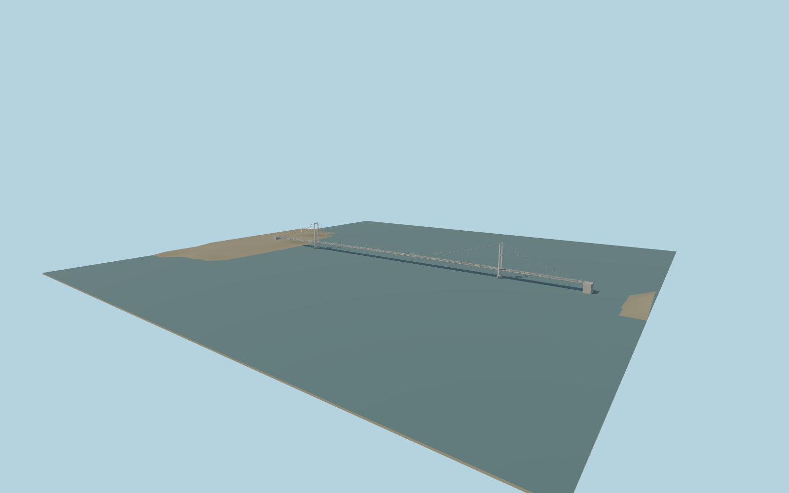

# Severn Bridge — severn_bridge

The original M48 Severn suspension bridge: two white steel portal towers, paired inclined hangers, continuous main cables, shallow aerofoil box deck, cantilever footways, cutwater piers and concrete cable anchorages. Includes close-view cable sockets, parapets, tower saddles, access doors and four traffic lanes.

## Source and browser models

The original detailed recipe is preserved at `content/worldgen/source/places/gc/gcn/severn_bridge/models/severn-bridge-model.mjs#buildSevern`. Original master hash: `sha256:41a39bb8d560fad968924a5f1cd2dc687f8af781a35c039da0be20e415d29450`. The current shared-material master has 308648 triangles and 24002716 bytes. It binds reusable painted metal and concrete graphs with metric UVs and embeds no texture images. Independent silhouettes live in `severn-browser-model.mjs`; four browser levels follow the1k/4k/16k/64k budgets.

## Approximate placement

Two inspected pictures confirm white portal towers, paired inclined hangers, continuous suspension cables and a thin deck. Standard viewer PMTiles named M48 bridge roads and tower-adjacent path offsets establish the main-span midpoint and east/southeast Aust-facing native+X. Mapped tower spacing986.5m matches the retained987.5m source within about1m. The named road includes a separate eastern approach, which remains outside this1637.5m suspension/anchorage asset. LocalY0 is deliberately accepted as an approximate global sea plane; no tidal or engineering datum certification. PMTiles water masks and raw terrain provide the surrounding review fixture; physical road endpoints remain approximate.

## Accepted limits

- Pictures and standard viewer PMTiles determine approximate fit; the working sea plane is not a certified vertical/tidal datum.
- Original detailed geometry is preserved and byte-reproduced; shared graphs supply reusable painted steel and concrete grain. Road material uses a dark aggregate approximation.
- Skyline uses representative suspension/hanger ribbons; district reconstructs broader cables. Street/closeup reductions simplify rails, fittings and narrow markings; source retains all authored geometry.
- Separate approach bridges are excluded. Connected road fitting is requested, but exact host endpoint joins and tides are not surveyed. Mapped-water preview is not bathymetry. Footprint replacement off; physical-device timings remain pending.

Regenerate with `node content/worldgen/source/places/gc/gcn/severn_bridge/models/generate-severn-bridge.mjs`; use `--check` for the selected source. QA reports bind the final inspected images and placement.
