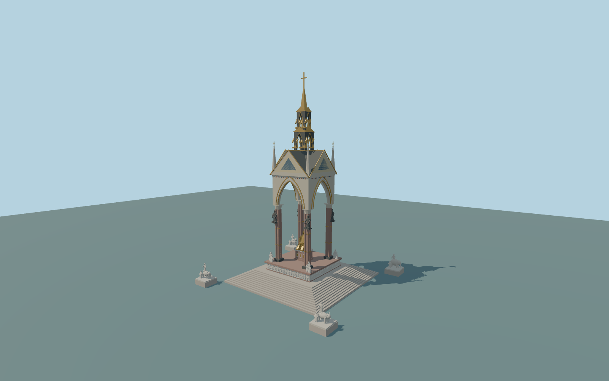

# Albert Memorial

Complete principal Albert Memorial exterior:central stepped podium andwhite geometric figurative frieze,four clustered reddish columns withdark bases/capitals,four genuinely open pointed canopy arches withclosed reveals,closed crossing-gable roof/colored geometric inlays,four corner pinnacles,two pierced spire stages andgold crown/cross,a seated gilded figure onits original geometric plinth/chair,andfour outer white allegory interpretations ontheir exact native plinth footprints withdistinct animal/human silhouettes. Original abstract figures/frieze/inlays replace copied portraits,mosaics,lettering andindividual sculptural likeness. Open precinct,outer fence/gates,paths/trees andneighbors remain native;no navigable interior claimed.

Rebuild: `node packages/worldgen/scripts/generate-albert-memorial.mjs`;append `--check` for exact source bytes. Select import/LOD/placement with `--ids=albert_memorial`. Detailed source and four browser tiers are separate ignored GLB outputs.

Complete principal Albert Memorial exterior:central stepped podium andwhite geometric figurative frieze,four clustered reddish columns withdark bases/capitals,four genuinely open pointed canopy arches withclosed reveals,closed crossing-gable roof/colored geometric inlays,four corner pinnacles,two pierced spire stages andgold crown/cross,a seated gilded figure onits original geometric plinth/chair,andfour outer white allegory interpretations ontheir exact native plinth footprints withdistinct animal/human silhouettes. Original abstract figures/frieze/inlays replace copied portraits,mosaics,lettering andindividual sculptural likeness. Open precinct,outer fence/gates,paths/trees andneighbors remain native;no navigable interior claimed.

54m approximate envelope comes fromthetwo ordinary photograph file descriptions;retained facts/currentmap haveno numeric height. Native central14.6by14.8m component andfourouter plinths guide actualscope. Canopy center[-.1763015,-3.5732855] differsfromprecinct anchor. Thirty-meter central stair base,5.2m podium,19.2m shaft heads,27m archcrown,34.5m crossing-gable crown,36.8m cornerpinnacles,two spire stages and54m cross arepicture-proportioned approximations. SourceY=0 usesone exterior stair-toe host sample at[-0.1763015,11.5267145],24.46188304348432m;closed support-6m. Exact paving/stair/plinth grades remainapproximate inunchanged globalterrain.

Onlytwo ordinary whole-monument pictures,current standard PMTiles andtwo unchanged standard Terrarium tiles. Original geometric figures/allegories,animal archetypes,frieze,face/robe poses,roof inlays andspire ornament approximate recognizable density/materials withoutclaiming exactsculpture,painted mosaic,inscription orhistorical costume accuracy. Hidden inventory/vault shape andprecise grades remainapproximate. Independent precinct railing/gates areexcluded. NumericalLOD surfaceerrors andphysical-device timings unmeasured.

Six existing shared256px rawlimestone,marble,granite,castbronze,paintedmetal andglazedtile graphs in six groups maximum;metricUVs/linear colors,zero private/embedded images. Skyline preservesallfour pointed arches,closed cross-gable roof,spire/cross,seatedfigure andfourgroup proxies. District hasclusteredcolumns,pointed molding,inlays andsimplified original human/animal groups;street addsgeometric frieze andgoldcollars;closeup/master refine relief figures,robe/face forms,individual collar bands,pinnacles andupper statuary. Detailed source remains separate.

Original geometry:repository license. Map:© OpenStreetMap contributors,ODbL-1.0;Protomaps. Standard terrain:terrain-grid.json. Ordinary pictures stay local and are not redistributed or used as textures. Current acceptance:qa.json.
