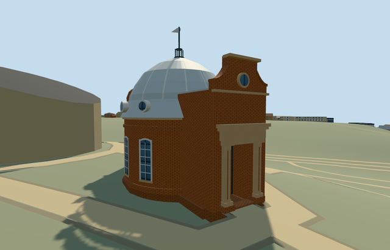

# altazimuth_pavilion_royal_observatory_greenwich — Altazimuth Pavilion, Royal Observatory Greenwich

Reviewed 2026-10-22. **Completed medium-fi exterior with approximate native placement; Observatory collection remains5/7.**

## Built and inspected

Independent Altazimuth Pavilion: circular red-brick body with white arched sash heads, pale ribbed dome and six roof-skirt circular lights, projecting terracotta portals with columns/entablatures, different shaped north and curved south parapets, small open finial and schematic static comet vane. Both entrances have real recesses, closed floors and soffits. Two ordinary photos and the existing map/terrain extract guided one continuous author/inspect/fix pass. Replaced thin parapet strips with solid coping, added metal portal roofs and corrected window heads. Recorded the five contained mapped building parts as integral; moved the whole-building review camera out from behind the independent planetarium.

## Shared materials and browser LODs

Four existing 256 px graphs: brick walls/base, stone_limestone_raw tinted terracotta for molded-clay portal ornament and pale details, metal_painted dome/roofs/frames/finial and storefront opaque glass. Raw stone is an explicit shared substitute for terracotta. Five textured draws and one skyline draw. No new graph, private atlas or embedded image. Tangent-projected facades, linear tints and separate POSITION/NORMAL streams retained. Each graph reads once in native textured runs; unload disposes all model geometry.

| Level | Triangles | Bytes | Draws |
| --- | ---: | ---: | ---: |
| skyline | 956 | 87272 | 1 |
| district | 3264 | 273476 | 5 |
| street | 4836 | 404056 | 5 |
| closeup | 5524 | 450708 | 5 |

Four authored LODs 956 / 3264 / 4836 / 5524 triangles, within1k/4k/16k/64k caps. Initial skyline+district geometry 360748 bytes, with shared material bakes cached separately. Six GLBs have zero Khronos errors/warnings;72 actual geometry/contact probes and six actual detailed PMTiles level15 cases pass. No matching13/14 records. Inspected48 current portable/shared/medium-fi/native frames including failure, all four LODs, Economy/High and noon/late light. Physical device/dense-city timings remain pending.

## Geographic placement

Approximate native exterior fit accepted. Shared Q192988 plus unique way268533441/native35184640622273 and five contained building parts (ways1462323346/3347/3349/3350/3351). Own anchor[-0.0008725297720465719,51.477339259593734], east/south axes baked into heading0; north and south portal assignments follow the photos and mapped projecting ends. Uncovered south approach[0,6.95] sets datum47.73069916666667m, floor0.2m above it. Original boundary grades -0.455..+0.002m leave a modest base. Only the parent occupied footprint cuts ground; replace its parent plus five integral parts and retain all1296 independent resident/1833 wider buildings, including the four earlier Observatory assets, planetarium, South Building and southwest annex. Original201x201/6m grid, roads and9681.379312m² water retained. Failure keeps all1302 originals; each LOD unload restores ground/water with zero live model geometry. The controlled test manually selects this asset with retained procedural neighbors. Exact historic thresholds, step clearance and accessibility remain approximate. Ground-cutout coordinates are quantized to 1 mm to avoid Float32 edge ambiguity; original elevations and mapped building ownership remain unchanged.

## Fidelity and limits

Photo-led medium-fi exterior. Parent footprint has no height; integral parts carry unqualified3.4/4.5/5/7.8m hints. Working body radius3.75m/eaves4.3m, skirt5.35m, crown8.4m, north parapet7.1m/south7m and vane10.6m are reconstructed. Portal/window/porthole inventories, rib counts, shaped parapet/coping/column ornament, hidden faces and vane shape/bearing are simplified. Shared raw stone tinted terracotta substitutes for molded clay. No optics, furnished rooms, working telescope/dome, copied signs/inscriptions, engineering survey or certified walking access. Separate campus structures retain their own assets and placements; this fifth member does not complete the Observatory candidate.

## Targeted checks

Selected generation/import/placement, strict medium-fi, scene/sim30 and recipe lint pass. Sim30 sha256:1f204931c687b1de76af560fc39d08250d1b0127129a4581644ea940a47561a2. Collection tests11+4 passed earlier in this Observatory round. Pins: [qa.json](qa.json); [source controls](map-frame.json).

## Viewed references

- https://commons.wikimedia.org/wiki/File:Altazimuth_Pavilion,_Greenwich_Observatory_-_geograph.org.uk_-_3877791.jpg — Paul Gillett; 2014-03-08; CC-BY-SA-2.0. Viewed only; no copied pixels.

- https://commons.wikimedia.org/wiki/File:Altazimuth_Pavilion_At_The_Royal_Observatory_Greenwich_2023_01.jpg — Julian Herzog; 2023-11-17; CC-BY-4.0. Viewed only; no copied pixels.

- https://www.openstreetmap.org/way/268533441 — independent Altazimuth footprint and five integral parts, ©OpenStreetMap contributors ODbL-1.0. Standard PMTiles/Mapzen, no bespoke terrain research.

## Completion checklist

- [x] Source rebuild, import, four authored LODs and existing shared materials.
- [x] Current actual source/shared/native views, geometry and lifecycle checks.
- [x] Independent identity, map orientation and approximate hillside placement.
- [ ] Two other required Observatory members.
