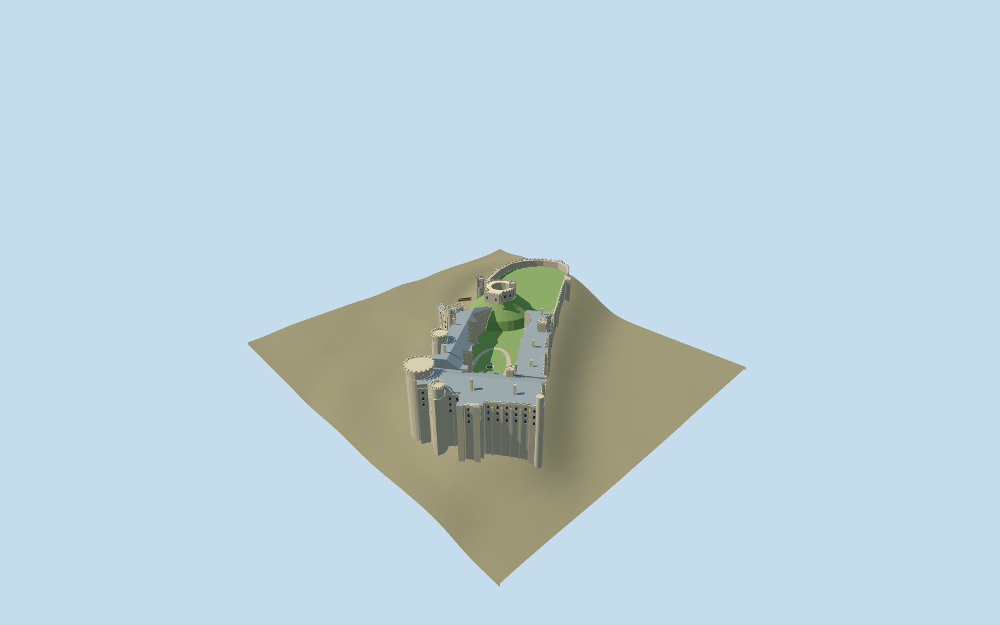

# Arundel Castle

Current Arundel Castle exterior: hollow Norman shell keep on its artificial motte, medieval northern curtain and gate defenses, open residential quadrangle with Gothic window rhythm, corbelled round towers, slate pitched roofs and chimneys.

## Evidence and reconstruction

Published dimensions and reconstructed details are separated in spec.json. Primary references:

- [Reference](https://api.openstreetmap.org/api/0.6/map?bbox=-0.5580,50.8543,-0.5500,50.8591)
- [Reference](https://api.openstreetmap.org/api/0.6/relation/1118816/full)
- [Reference](https://www.arundelcastle.org/explore/)
- [Reference](https://www.arundelcastle.org/)
- [Reference](https://www.arundelcastle.org/wp-content/uploads/2019/11/arundel-castle-set-on-a-hill.jpg)
- [Reference](https://www.visitengland.com/sites/ve/files/styles/page_header_ve_sm/public/lookatmedam/4364f7fe-54d0-40f6-afc2-181bcf4c191dl.jpg?h=14a770de&itok=EOBatrcD)
- [Reference](https://www.arundelcastle.org/wp-content/uploads/2019/09/castle-exterior-1.jpg)
- [Reference](https://historicengland.org.uk/listing/the-list/list-entry/1012500)
- [Reference](https://historicengland.org.uk/listing/the-list/list-entry/1027926)

Six existing shared 256-square stone, slate, timber and gravel graphs; flat glass and earthwork lawn. Metric repeats and linear tints. No embedded/new image, downloaded mesh or photo texture.

## Model and axes

15,379 triangles; 46,137 vertices; 8 material groups; 1,850,032 bytes. Native bounds: -84.429, -25.303, -144.204 to 123.611, 40.050, 129.524. Source hash: `sha256:359b5177ad7e3ad38ac7ed1bfd96d1c9ec41e1cb3710b8d48b75832ef67cf1c4`.

{"up":"+Y","longitudinal":"Long castle axis is NW/SE. Native +X east, +Z south; authoring major-axis rotation is baked into vertices, runtime heading 0.","origin":"Site anchor; Y0 standard PMTiles working datum."}

The inspected aerial picture supports the open oval shell keep on a steep bounded motte, crenellated gatehouse/curtains and later residential castle. Retained east/south map controls set approximate scale, footprint and orientation. Standard viewer PMTiles supply surrounding ground; architecture is raised6m to keep reconstructed courts above its coarse crest and bounded wall/motte toes reach it. The distinctive artificial motte is retained as landmark earthwork; broad surrounding hill/landscape is supplied by host terrain. Anchor -0.554513936,50.856706132; heading 0; standard PMTiles datum 40.68276429976586m. Floors are reconstructed and foundations extend below the coarse sampled ground.

## Reproduce

Run `node packages/worldgen/scripts/generate-signature-towers.mjs --ids=arundel_castle` (or add `--check`). The generator preserves manually edited masters by checking their baseline hashes. Import through the standard authored-model workflow with optimization disabled; then capture all QA cameras, including shared-surface views.

## Pending work

- Approximate current exterior and fit from inspected aerial picture and standard viewer PMTiles; no bespoke survey or exact thresholds.
- Detailed original master/hash/recipe preserved. Keep, motte, Gothic residential details and restored fixtures remain interpreted; interiors and collision excluded.
- Five common limestone/rubble/slate/wood/aggregate graphs plus explicit glass/lawn color slots, zero embedded images. Bounded artificial motte retained; surrounding landscape and vegetation excluded.
- Footprint replacement remains off; physical-device timing unmeasured.

This bundle follows the medium-fi standard. Medium-fi appearance and geographic fit are reviewed separately. Hash-bound visual acceptance is recorded separately after capture inspection.

## Additional geographic data

© OpenStreetMap contributors; Historic England; Arundel Castle Trustees; VisitEngland.
