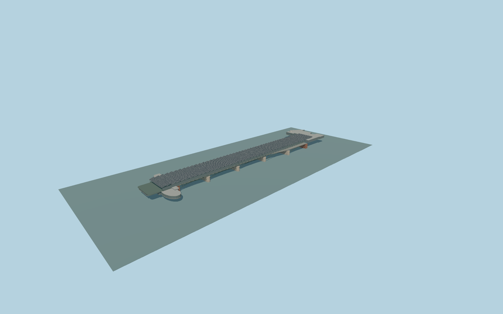

# Blackfriars station

Complete modern Blackfriars passenger-station exterior and its supporting river bridge: continuous solar sawtooth roof, glazed/open-sided elevated platforms, four rounded stone river piers and five open steel arch spans, both bank entrance buildings, closed entrance glazing, side stair/lift volumes and supported circulation. Keep original Thames water, riverbank paths, native rails, obsolete western railway piers, separate Blackfriars road bridge, northern offices and independent neighbors. No navigable interiors, trains, logos, shop brands or copied signage.

Rebuild: `node packages/worldgen/scripts/generate-blackfriars-station.mjs`;append `--check` for exact source bytes. Select import/LOD/placement with `--ids=blackfriars_station`. Detailed source and four browser tiers are separate ignored GLB outputs.

Complete modern Blackfriars passenger-station exterior and its supporting river bridge: continuous solar sawtooth roof, glazed/open-sided elevated platforms, four rounded stone river piers and five open steel arch spans, both bank entrance buildings, closed entrance glazing, side stair/lift volumes and supported circulation. Keep original Thames water, riverbank paths, native rails, obsolete western railway piers, separate Blackfriars road bridge, northern offices and independent neighbors. No navigable interiors, trains, logos, shop brands or copied signage.

One common unchanged standard river-field datum at local[0,40], -2.1916976666666668m suppliesY=0. Approximate source bridge deck11m, sawtooth roof16.2-18.1m, north entrance floor10.4m/roof16m andsouth entrance floor7.2m/roof11m are photo/map-proportioned stage controls,not surveyed elevations. Native deckmin9/max11m androof15m are retained asmapfacts ratherthan silently overwritten. Preserve original water andbank paths;no artificial river floor,plaza,terrain flattening orper-part host offsets.

Two ordinary photographs plus current viewer PMTiles; no bespoke research or downloaded meshes. Roof bay count, steel sections, hidden entrances and floor levels are photo/map-proportioned medium-fi approximations. Entire connected station exterior andbridge,not the adjacent roadbridge,old westernpiers,northern offices orother neighbors. Hidden north/south circulation,bridge crossmembers andpanel counts are coherent original medium-fi approximations. No logos,brands,trains,copied lettering,construction scaffolding or navigable interiors. Exact tide,bank thresholds,clearance andurban terrain contact remain approximate. Physical-device timings andnumerical LOD errors remain unmeasured.

Six existing shared256px limestone,granite,brick,painted-metal,window-grid andplain-concrete graphs;seven groups maximum. MetricUVs,linearcolors andzero private/embeddedimages. Skyline retainsallfive open arches,fourpiers,roof andbothbanks. District keeps49roofbays,coarsepiers andclosedbankentrances. Street addsrealdoorrecesses,metalframes,bracing andstairs. Close-up addsfinearchspandrels,rail sleepers,solar-panelgrid,roofmullions androunderpiers. Master separatelyrefines curves andstructuralmembers.

Current replacement test corrected the initial ownership interpretation: four western pier ends75/76/83/84 lie beneath and support the active broadened bridge and are represented by the four complete transverse source piers. The eight farther-west obsolete pier components remain native. Nested northern parts87 and89 lie wholly inside the station entrance parent64; they are represented explicitly as a closed lift/service core and lower concourse. No independent office,road bridge or neighboring building is removed. Exact service functions and hidden appearance remain original approximations; part89 has no underground layer tag or confirmed separate subway identity.

Original geometry:repository license. Map:© OpenStreetMap contributors,ODbL-1.0;Protomaps. Standard terrain:terrain-grid.json. Ordinary pictures stay local and are not redistributed or used as textures. Current acceptance:qa.json.
