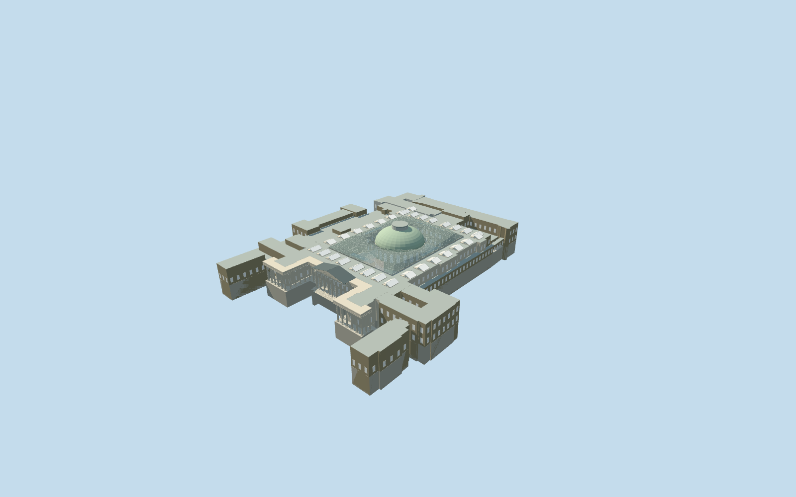
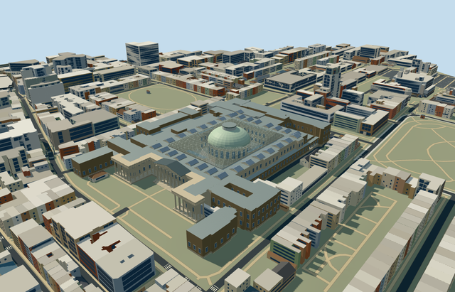

# british_museum — British Museum

Reviewed2026-10-20 in one author/build/inspect/fix pass.

## Appearance

Inspected48 final current source, shared-material, medium-fi and native views. Specific irregular British Museum gallery wings/open southern forecourt, mapped Ionic colonnade/tapered fluted shafts/exposed spiral capitals/overhead entablature and triangular geometric relief pediment; original-contact south steps; brick-sided gallery wings/rooflights and modern northwest conservation-service masses. Great Court curved triangular translucent roof/lattice, occupied public court and Reading Room stone drum/rounded arched upper windows/pale green dome/lantern remain distinct. Exposed the capital spirals, rounded the window arches and added the upper stone cornice during one continuous construction/review pass. No copied inscriptions, banners, artwork or furnished hidden galleries.

## Shared surfaces and browser budgets

Six existing256px graphs: stone_limestone, brick, concrete_plain, metal_painted, metal_standing_seam and window_grid. All stone, brick, modern wings, frame/dome/roofs and windows reuse the library. Seven near draws/one skyline draw; no new graph, embedded image or private atlas. Great Court roof uses one local image-free22percent alpha PBR surface, with closed front/back shell and boundary caps. Each required graph read once; separate POSITION/NORMAL streams and equal CPU/GPU accounting. Shared opaque windows and approximate clear roof transmission do not reproduce exact architectural optics.

| Level | Triangles | Bytes | Draws |
| --- | ---: | ---: | ---: |
| skyline | 987 | 84924 | 1 |
| district | 3965 | 381692 | 6 |
| street | 15548 | 1540592 | 7 |
| closeup | 62718 | 6308928 | 7 |

Four authored browser levels retain the irregular complex, forecourt/portico/pediment, Great Court opening/Reading Room dome and lantern. Fine column flutes/spirals, roof lattice, rounded windows and rooflights appear near. Levels 987/3965/15548/62718triangles; initial skyline plus district 466616bytes, below3MB phone/6MB laptop initial asset targets. Physical ordinary-laptop/phone/tablet and dense-city timing measurements remain pending.

## Approximate native placement

Retained Q6373 and named native British Museum parent52776558310292 establish identity. Great Court52776559288515 supplies73.471258x97.459877m rectangular control and axis; parent124-point outer/16-point court opening plus327 integrated owned building parts preserve the actual irregular approximately202x243m complex. Native part ownership was checked against the parent footprint; separate terraces are retained. Forty-six mapped column/pilaster controls and244 mapped triangular roof parts guide the colonnade/lattice; those are map-control counts, not certified architectural inventories. Anchor[-0.12693530390150834,51.51943525215383]/heading0/native east-south/internal X[0.8179741382489796,-0.5752549948986443]/Z[0.5752549948986443,0.8179741382489796]. Positive internalZ faces the southern entrance. Fine20degree/2m facing remains approximate. Production helper replaces only the328 integrated British Museum parent/part records. All1680 independent resident buildings of2008 originals and all3660 wider independent buildings of3988 remain unchanged, including neighboring Bloomsbury terraces/utilities. Original6m grid, native roads and525.5310447589727square metres water remain unchanged.340 actual PMTiles13/14/15 cases pass, including all328 owned detailed records. Detailed ownership uses99.5percent coverage; generalized complexes use bounded clipping. Failure retains2008 originals; all four levels unload restore original terrain/water and zero live model geometry. Original standard6m Mapzen grid, roads and every independent native building remain unchanged. Datum24.72098383331686m defines modelY0; owned samples span-11.83676332468735..1.0661824731532334m. Occupied foundation/court floor follows the actual museum mask, with steps partitioned from its cap. Bounded ground opening intersects every authored foundation level so no outside terrain is removed. Original-contact buried foundations support the gallery volumes; mapped raised colonnade platform carries the columns. Only328 integrated museum records are replaced using99.5percent detailed coverage; generalized mixed complexes use bounded clipping. No whole Bloomsbury/forecourt precinct slab or terrain flattening. Failure/unload retains/restores original context.

## Limits

Three ordinary photographs actually viewed:2012 southern frontage,2015 aerial complex and2005 Great Court roof. These establish the front Ionic colonnade/pediment, gallery wings/rooflights, green dome/lantern, northwest modern mass and curved lattice adjoining the Reading Room upper cornice/rounded windows. Photographs viewed only/no copied pixels. No bespoke survey, archive or terrain research. Unmapped furnished galleries/Reading Room interior, hidden plant, temporary banners/artwork and future masterplan proposals excluded. Mapped building-part heights/min-heights are retained but have unqualified datum. Working museum floor2m above original anchor datum24.72098383331686m; column shafts/capitals2..17m/overhead beam17..20m/pediment24m, original gallery masses mostly17..23m, Reading Room drum20m/dome34m/lantern37m. Shared roof-vertex averages from mapped triangular height controls form a continuous surface; outer/inner edge heights are stitched to gallery21m/drum20m. Near tessellation, Ionic flutes/spirals and relief motifs, rooflight/window inventory and cladding optics are picture-led approximations rather than a survey, certified3312-pane inventory, structural/access or furnished-interior reconstruction. Photographs2005/2012/2015 establish visible form, not current-condition certification; proposed redevelopment excluded.

## Selected checks

Six Khronos files: zero errors/warnings.1777 actual geometry/material/contact checks,48 current inspected views,340 actual native map-level cases. Selected source/import/placement/strict medium-fi/scene validation/lint pass. Sim30 hash96df514026f04b8c3703adefe737fbf36a6e16b84f724088203ef3a53e538363.

Source sha256:71e71b581c3d111b1e6e6d9829056c803aa4a23cffb1b563967551dee545e954

Runtime sha256:71866aac889eb0d312d01e4f1a1dd5699094cdea63b5ada3d7d089fae4a2ad6e

Input sha256:3463528f6b456e95d198966a14b3e00a41fb6a2297d4f99ca32f6216e966e3c2

Rebuild: node packages/worldgen/scripts/generate-additional-landmarks.mjs --ids=british_museum; node packages/worldgen/scripts/import-structure-models.mjs --ids=british_museum; node packages/tooling/scripts/generate-landmark-lods.mjs --ids=british_museum --force.

## Ordinary picture references

https://commons.wikimedia.org/wiki/File:The_British_Museum_(Front).jpg — https://thumb.wikimedia.org/wikipedia/commons/thumb/e/ec/The_British_Museum_%28Front%29.jpg/960px-The_British_Museum_%28Front%29.jpg; Andres Rueda; CC-BY-2.0; viewed only/no copied pixels. Viewed only/no copied pixels.

https://commons.wikimedia.org/wiki/File:British_Museum_(aerial).jpg — https://thumb.wikimedia.org/wikipedia/commons/thumb/8/86/British_Museum_%28aerial%29.jpg/960px-British_Museum_%28aerial%29.jpg; Luke Massey and the Greater London National Park City Initiative; CC-BY-2.0; viewed only/no copied pixels. Viewed only/no copied pixels.

https://commons.wikimedia.org/wiki/File:British_Museum_Great_Court_roof.jpg — https://thumb.wikimedia.org/wikipedia/commons/thumb/1/19/British_Museum_Great_Court_roof.jpg/500px-British_Museum_Great_Court_roof.jpg; Andrew Dunn; CC-BY-SA-2.0; viewed only/no copied pixels. Viewed only/no copied pixels.
