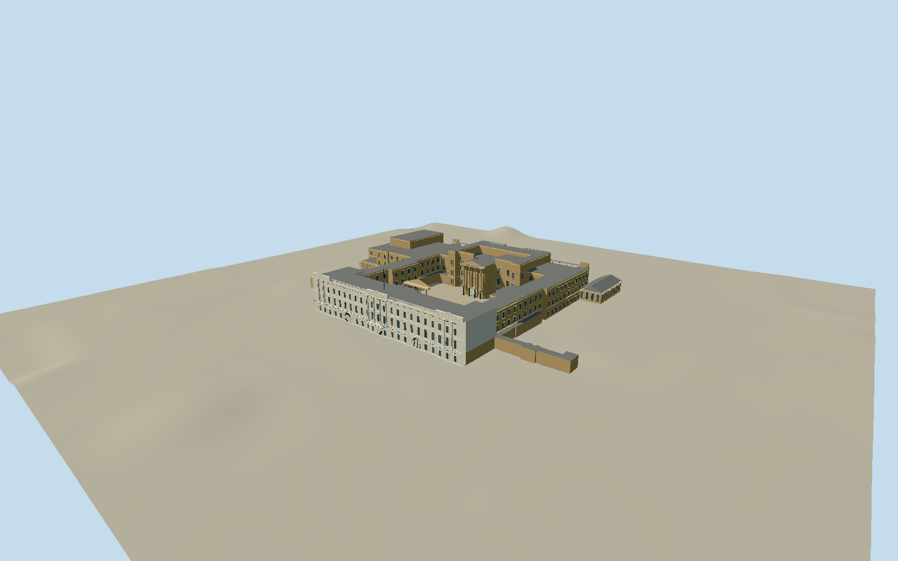

# Buckingham Palace

Individual palace quadrangle with native courtyard voids, pale Portland-stone three-pediment east facade in 3:7:3:7:3 bay rhythm, rusticated low storey/mezzanines, real arched carriage passages, divided sash glazing and giant Corinthian orders. Continuous first-floor balustrade and ceremonial balcony, pierced rooftop balustrade, original simplified pediment relief and bare flagstaff. Distinct warm Bath-stone garden front with engaged-column five-window bow, shallow green copper half dome, tall attic, giant-column pavilions, raised terrace/balustrades and conservatory. Attached palace wings/ballroom, courtyard porticoes and Ambassadors’ Court temple porch. Separate Royal Mews, memorial, gates, neighbors, people, interiors and photo textures excluded.

Authoring state: **review-in-qa.json**. Current completion evidence is in [qa.json](qa.json) and the [local 100 ledger](../../../../qualla-structures/batches/PROGRESS.md).

- [Buckingham Palace: The House That Became a Throne](https://qualla.com/buckingham-palace/)

Four local originals individually inspected; all 78 candidate contact views inspected. Many candidates are interiors, a Shenzhen replica, nearby landmarks, gates, vehicles or historical images and cannot control the palace exterior.

Nominal 108m frontage, 120m quadrangle depth and 24m height are primary owner controls. Native front is approximately 107.9m wide; projections, attached south blocks and conservatories extend beyond the nominal main rectangle. Preserve native outlines rather than scaling the parcel to these numbers.

Main palace quadrangle, garden bow, attached conservatory/ballroom and Ambassadors’ Court masses only. Separate Royal Mews and Riding School, forecourt gates, Victoria Memorial, gardens, neighbors, interiors, people, guards, vehicles, temporary works/canopies, banners and photographic textures are excluded.

Qualla narrative dates the balcony to the 1913 refacing; owner records place its introduction with the 1847–1849 wing and appearances from 1851. Story content is not changed by this modeling work.

Native generalized component heights of 6/12/18/21/24m are massing evidence, not surveyed storey levels. Intermediate heights, unseen facade bays, stone detailing, roof engineering and flagstaff dimensions require conservative interpretation.

The owner aerial page was located and the image opened, but browser pixel capture failed. No aerial imagery has been visually inspected for this model yet.

Independent original terrain must be acquired before authoring. No terrain fitting/flattening or footprint replacement. Ground contacts and raised terraces must be tested against the actual samples.

The native6m Ambassadors’ Court porch projection is interpreted as an open colonnade, with its solid low wall recessed behind real columns and a pitched temple roof. Original footprints remain preserved. This changes the authored mass partition, not the host terrain or map evidence.

Build: `node packages/worldgen/scripts/generate-authored-places.mjs --ids=buckingham_palace`. Add `--check` to verify exact regeneration. 63641 triangles; 7 materials; no embedded photographs.
