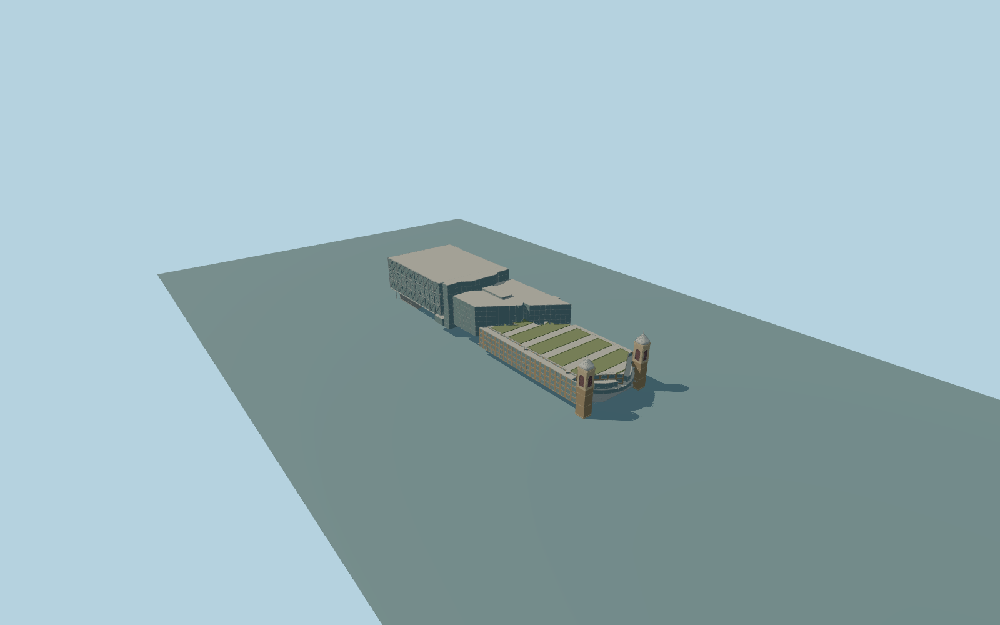

# Cannon Street station

Complete permanent Cannon Street station overbuild ensemble within mappedparent277:modern north CannonPlace glass-and-exterior-steel volume and recessed street concourse;middle stepped office/core roofs;whole southern curved CannonBridgeHouse over-platform volume with roof-garden abstraction;both original riverside brick/stone towers with arched belfry bays,domed metal caps andspire tips;open elevated mainline approaches. Preserve river,railwaybridge,adjacent independent offices/Dowgate blocks,alleys andstreets. No copied lettering,roundels,logos,people,trains,operational interiors or historic train-shed reconstruction. Glazed entrance box is set behind the outer office/steel tube facade by about4.7m at the north front and4-6m at side edges,with structural overhang columns;no lettering orcopiedgraphics.

Rebuild: `node packages/worldgen/scripts/generate-cannon-street-station.mjs`;append `--check` for exact source bytes. Select import/LOD/placement with `--ids=cannon_street_station`. Detailed source and four browser tiers are separate ignored GLB outputs.

Complete permanent Cannon Street station overbuild ensemble within mappedparent277:modern north CannonPlace glass-and-exterior-steel volume and recessed street concourse;middle stepped office/core roofs;whole southern curved CannonBridgeHouse over-platform volume with roof-garden abstraction;both original riverside brick/stone towers with arched belfry bays,domed metal caps andspire tips;open elevated mainline approaches. Preserve river,railwaybridge,adjacent independent offices/Dowgate blocks,alleys andstreets. No copied lettering,roundels,logos,people,trains,operational interiors or historic train-shed reconstruction.

Native north overbuild42m,middle38/46m,garden block24m/side23m,curved front16/20m,min13m;two tower shafts35m,cap35–40.5m,tips44m,with21/33.5/34m ledges. Parent277 is an ownership envelope,never a cuboid. Source raised platform/northconcourse7m,north soffit12m,middle underside13m andfootings-8m are explicit architectural estimates;native min-height values are retainedfacts,not surveyed rail/street levels. One unchanged standard global field sample outside the west-middle station side[0,55],6.066517m,defines commonY=0. No per-part runtime offsets or surveyed threshold claim. Raised station deck/northconcourse are fixedsource7m architectural interpretation;the north street field rises toward this level.

Two ordinary present-day-family photographs andcurrent PMTiles establish approximate whole-ensemble shape. Fine hidden windows,roof services,exact floor inventory andthreshold/rail grades remain unverified. Roof-garden shapes are regularized lawn/low-hedge abstraction,without plant species/furniture claims. Source has open elevated track approach,not navigable station interior. Physical-device timings andnumericalLODerrors remain unmeasured.

Seven existing shared256px graphs:brick,stone_sandstone,stone_granite,metal_standing_seam,metal_painted,window_grid andmembrane;one palette roof group for abstract green planting. At most8mergedsemantic groups,metricUVs,linearcolors;no embedded/private images. Office andconcourse panes usewindow graph;brick/stone/roof/steel retainopaque semantics. Skyline keeps complete north/middle/garden massing andboth domed tower silhouettes withcoarse source-derived boundaries. Districtadds glazing/outer steel family,greenroofpatches andtower arches;streetadds recesses/reveals,sampled mullions,openrails andlow-facet tubes;closeupkeeps fullwindowinventory,finer external tubes,domeseams,louvres/gardenrails;masterrefines sourcecurves,frames,soffitstrips andsleepers.

Original geometry:repository license. Map:© OpenStreetMap contributors,ODbL-1.0;Protomaps. Standard terrain:terrain-grid.json. Ordinary pictures stay local and are not redistributed or used as textures. Current acceptance:qa.json.
