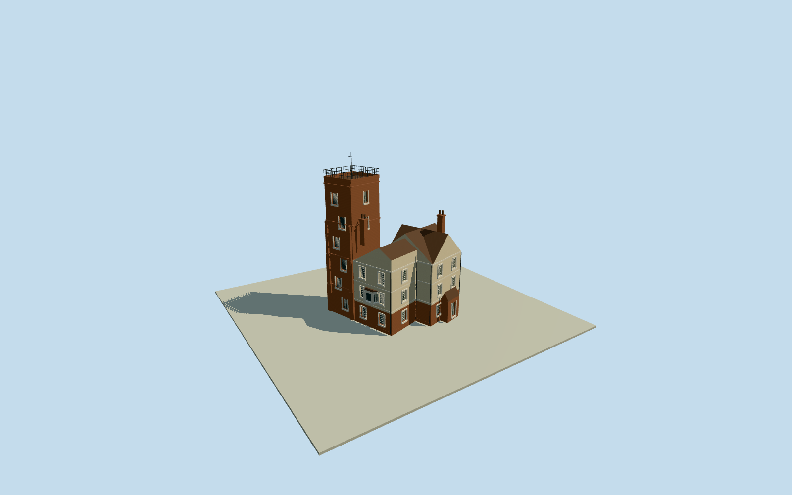

# Canonbury House and Canonbury Tower

Whole native eight-control Canonbury Tower/attached lower house ranges: tall brick stair tower/stepped casements/offset north buttresses/four string-course stages/flat parapet/open roof rail/weather vane; plastered gabled west and cross-gabled south ranges, canted wooden window bay/intrinsic low porch/entry steps/two chimneys/short low hall-link. Published Cooke1827CC0 engraving and Dixon1880PD photograph plus primary listing text. Native whole plan retained; tower subdivision/heights/hidden details/current repairs bounded. Separate named house/school/gardens/pond excluded.

Authoring state: **review-in-qa.json**. Current completion evidence is in [qa.json](qa.json) and the [completion ledger](../../../../qualla-structures/batches/qualla-002.PROGRESS.md).

- [Canonbury House and Canonbury Tower](https://qualla.com/canonbury-house-and-canonbury-tower/)

Native whole eight-control physical tower/attached-ranges building way230254103. Tower subdivision, projecting bays/entrance steps and short intrinsic hall connector will be explicit photo/text-derived parts; no property rectangle or invented native tower subpolygon.

Whole surviving tower with physically attached lower house/west/east/south ranges and intrinsic bays/porch/short low hall-link connector. Use actual eight native outer controls. Tall tower position/roof parts within envelope are explicit photographic/listing-text estimates. Separate modern named CanonburyHouse, school/KingEdwardHall, terraces, detached garden houses, vanished pond/gardens, site pad/fences and interiors excluded.

Original field frozen before once-only street-side floor sample and all main heights/parts. Provider heights do not establish exact thresholds or foundation contact. Preserve this floor/mainsections/worldframe/originalfield thereafter; preview/replacement false.

Only exact published Cooke1827YaleCC0 engraving and Dixon1880public-domain photograph supply imagery. Primary HistoricEngland1280424 is used as technical text only. Current plaster/brick colors/roof partitions/hidden facades/window census/bay detail/alterations are original bounded estimates; no surveyed current fitout or exact restored ornament is claimed. Historical ivy/pond/fences/gardens/interiors and image pixels excluded.

All eight native exterior controls retained in physical foundation/house ranges at all levels. Tower subpart uses explicitly reconstructed northeast subdivision within native outline near independent mapped tower point. Canted bay, porch/stairs and short hall-link are intrinsic derived architecture; separate named modern house/school/former hall and detached garden houses are excluded.

Original native frame/256m129field/floor/mainsections fixed before geometry; no source-field replacement/fitting/flattening/reframe/reacquisition/raising. Exact threshold/foundation contact unverified, geographic preview/replacement false. Flat review ground and synthetic neighbors are fixtures.

Build: `node content/worldgen/source/places/gc/gcp/canonbury_house_and_canonbury_tower/models/generate-canonbury-house-and-tower.mjs`. Add `--check` to verify exact regeneration. 8354 triangles; 6 materials; no embedded photographs.
