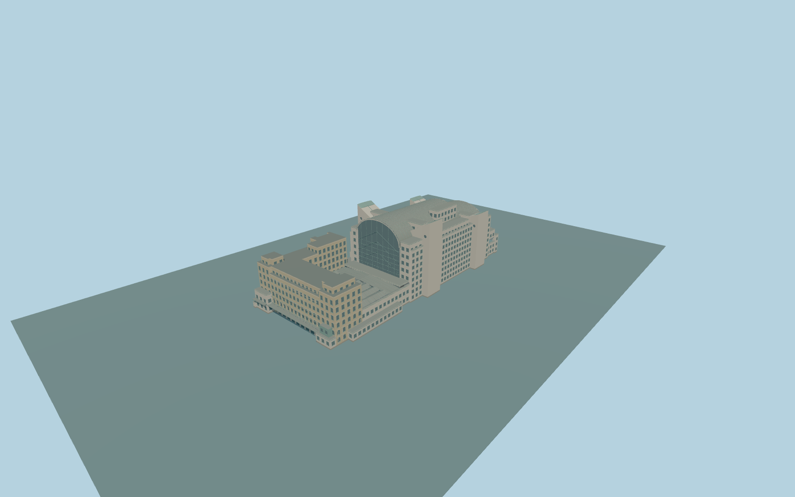

# Charing Cross railway station

Complete permanent Charing Cross passenger-building ensemble: historic pale yellow-brick hotel and station entrance, corner pavilions, balconies and low entrance canopy; seven mapped concourse roof folds; the full modern pale-stone office mass, both stepped barrel roofs, arched glazed ends, turquoise oriel, flanking pylons, lateral ranges and elevated station deck. Keep the rail approach, Hungerford Bridge, river, independent city blocks, Embankment tube station and hotel forecourt separate. Exterior only; no trains, copied brands, lettering, figurative sculptures or navigable interior.

Rebuild: `node packages/worldgen/scripts/generate-charing-cross-railway-station.mjs`;append `--check` for exact source bytes. Select import/LOD/placement with `--ids=charing_cross_railway_station`. Detailed source and four browser tiers are separate ignored GLB outputs.

Complete permanent Charing Cross passenger-building ensemble: historic pale yellow-brick hotel and station entrance, corner pavilions, balconies and low entrance canopy; seven mapped concourse roof folds; the full modern pale-stone office mass, both stepped barrel roofs, arched glazed ends, turquoise oriel, flanking pylons, lateral ranges and elevated station deck. Keep the rail approach, Hungerford Bridge, river, independent city blocks, Embankment tube station and hotel forecourt separate. Exterior only; no trains, copied brands, lettering, figurative sculptures or navigable interior.

All 70 native part heights and min_height facts are retained as inputs. The source has a hotel floor at+.65m, an elevated railway deck at3m and closed upper offices above14m on one common host datum. Native min_height values7/8/9m describe generalized assemblies; photographs require open rail space, thin ledges and supports rather than fully filled cuboids. The central16m/11m mapped blocks become thin upper ledges, and the9-to15m connector has a14m upper closed floor. Peaks30/34m hotel,50/42m barrels and52/44m pylons remain explicit; pylon caps reach their mapped peak. Seven concourse folds plus their cross-roof follow the15m mapped roofs. Only actual lower closed building floors receive ground masks. No parent-wide ground floor, outside plaza or per-part host offsets. One common unchanged native field sample immediately outside the actual hotel entrance at[-91,0],8.782510200000004m,defines Y=0. Native contact remains to review. No per-part host offsets.

Three ordinary photographs inspected: Strand hotel frontage, modern river-side view and modern arched platform-end view. Exact hidden openings, hotel rear, small roof parts, portal inventory and current works remain medium-fi approximations. Current PMTiles supply all 70 nested building parts and their heights/min_height. The modern arches and roof profiles are photo-proportioned within mapped bounds. The separate Eleanor Cross monument and neighboring hotel annex are preserved as independent native features rather than copied or silently claimed. Exterior only. Window inventory, pylon slopes, canopy sections, under-office grades and numerical LOD errors are approximations. Physical-device and dense-city timing remain unmeasured.

Six existing shared256px limestone,brick,granite,painted-metal,slate andwindow-grid graphs, with at most eight merged semantic groups. Metric UVs and linear colours, no private or embedded images. Skyline retains the full hotel, two barrel masses, pylons and elevated deck; district adds coarse windows; street adds actual recesses and circular pylon windows; close-up adds rails, barrel ribs, arch bracing and roof caps. Master refines facade frames and curves. LOD error values are estimates.

Original geometry:repository license. Map:© OpenStreetMap contributors,ODbL-1.0;Protomaps. Standard terrain:terrain-grid.json. Ordinary pictures stay local and are not redistributed or used as textures. Current acceptance:qa.json.
