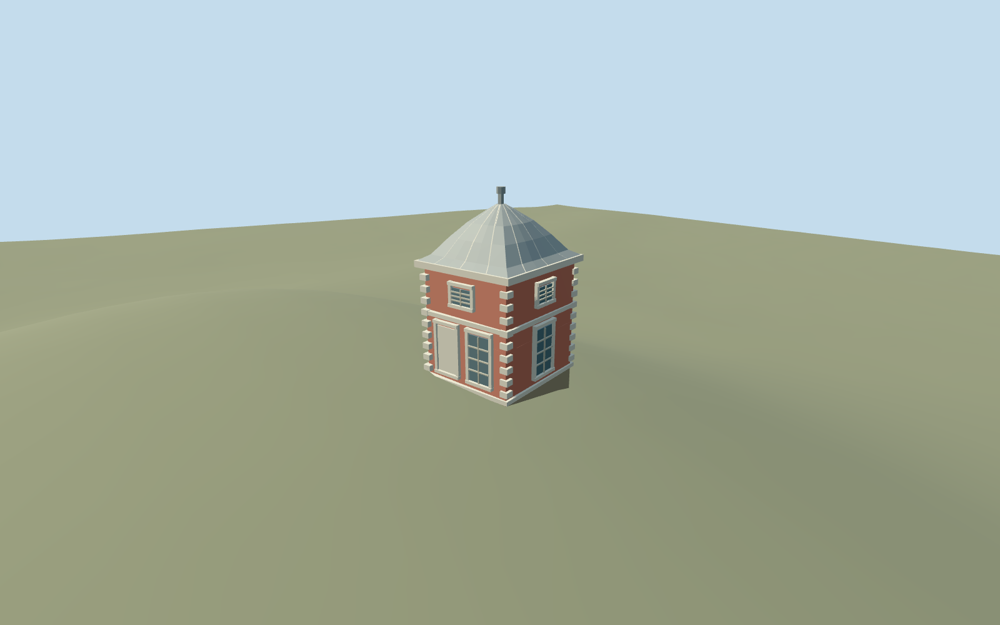

# Eastern pavilion and Camera Obscura, Royal Observatory Greenwich

Independent eastern pavilion/Camera Obscura at the north edge of the Royal Observatory courtyard. Square red brick two-storey volume with white stone quoins, string courses and cornice, rounded lead-colored roof/cap and finial, lower tall windows/blank panel and shorter upper lights, true recessed west side entry. Flamsteed House, Meridian range, Great Equatorial dome and other campus members remain independent assets.

## Evidence and reconstruction

Published dimensions and reconstructed details are separated in spec.json. Primary references:

- [Reference](https://commons.wikimedia.org/wiki/File:Flamsteed_House_Greenwich_2023_01.jpg)
- [Reference](https://commons.wikimedia.org/wiki/File:Flamsteed_House_-_Royal_Observatory_Greenwich_(8131031429).jpg)
- [Reference](https://commons.wikimedia.org/wiki/File:Flamsteed_House_Royal_Observatory_from_National_Maritime_Museum_colonnade_Greenwich_London_England_02.jpg)

Independent eastern pavilion/Camera Obscura at the north edge of the Royal Observatory courtyard. Square red brick two-storey volume with white stone quoins, string courses and cornice, rounded lead-colored roof/cap and finial, lower tall windows/blank panel and shorter upper lights, true recessed west side entry. Flamsteed House, Meridian range, Great Equatorial dome and other campus members remain independent assets.

## Model and axes

1,842 triangles; 4,486 vertices; 5 material groups; 187,016 bytes. Native bounds: -3.207, -1.062, -3.449 to 3.251, 9.000, 3.385. Source hash: `sha256:cfa4d42eb2103bd27e90e0bd68a68e20ef8c1621c0817461123c009455df360f`.

{"x":"east","y":"up","z":"south"}

The geographic proposal uses exact-QID OpenStreetMap evidence. Map-derived orientation and estimated architectural details require real-site visual review; preview eligibility is distinct from geographic/fidelity approval. Map attribution: © OpenStreetMap contributors, ODbL-1.0.

## Reproduce

Run `node packages/worldgen/scripts/generate-additional-landmarks.mjs --ids=eastern_pavilion_and_camera_obscura_royal_observatory_greenwich` (or add `--check`). The generator preserves manually edited masters by checking their baseline hashes. Import through the standard authored-model workflow with optimization disabled; then capture all QA cameras, including shared-surface views.

## Pending work

- Independent eastern pavilion/Camera Obscura at the north edge of the Royal Observatory courtyard. Square red brick two-storey volume with white stone quoins, string courses and cornice, rounded lead-colored roof/cap and finial, lower tall windows/blank panel and shorter upper lights, true recessed west side entry. Flamsteed House, Meridian range, Great Equatorial dome and other campus members remain independent assets.
- Shared campus Q192988 with independent way268533443/native35184640622275. Its small rotated square footprint lies northeast of Flamsteed House and matches the detached domed pavilion visible in the court and north photographs. Use its own anchor, not the campus POI. InternalX east-northeast andZ south-southeast follow the footprint, heading0 with native east/south orientation baked in. Do not suppress any other Observatory building.
- No map height. Working two-storey brick wall5.5m, cornice5.65m, lead cap8.1m and finial8.8m are ordinary-photo estimates. White quoins, string bands, short upper lights and tall lower lights are simplified inventories. The west side entry and hidden east elevation are reconstructed proxies; no camera optics/interior, lettering or copied signage.
- Original standard Protomaps20261020/Mapzen201x201/6m extract reused from Observatory review. Uncovered court control immediately west of the door at internal[-3.2,0], absolute datum45.70766003019248m. Floor0.2m above control, closed brick foundation follows the original minimum footprint grade. Only occupied pavilion floor cuts terrain; retain the courtyard, provider, Flamsteed House, every independent building, roads and water. Approximate exterior fit reviewed2026-10-22 after moving the provider immediately outside the west doorway. Boundary grades span -0.91..+0.43m; slight uphill plinth burial and downhill brick base retained on the original hill. Exact historic terrace/thresholds and accessibility remain approximate.

This bundle follows the medium-fi standard. Medium-fi appearance and geographic fit are reviewed separately. Hash-bound visual acceptance is recorded separately after capture inspection.
