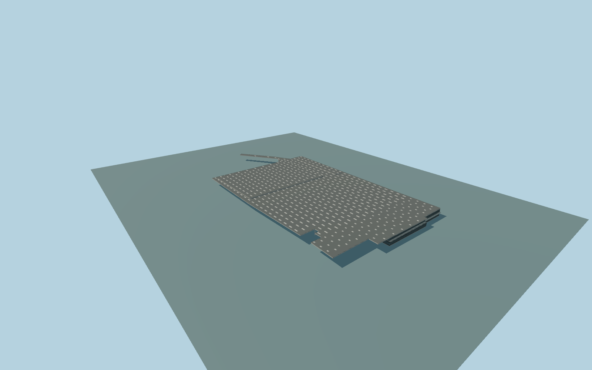

# Euston Station

Complete existing Euston passenger-station ensemble:whole mapped dark flat platform roof,raised secondary roof assemblies,regular pale rooflight field,full enclosed SSE concourse with deep pale fascia,recessed upper glass,narrow terrace/rails,dark lower entrance frontage andlower entry returns;open NNW rail approach with actual structural columns/beams. Preserve independent forecourt kiosks,office towers,city blocks,roads/rails andHS2cleared/temporaryworks. Exterior only;no copied signs,lettering,brands,people,trains or navigable interior/futureHS2proposal.

Rebuild: `node packages/worldgen/scripts/generate-euston-station.mjs`;append `--check` for exact source bytes. Select import/LOD/placement with `--ids=euston_station`. Detailed source and four browser tiers are separate ignored GLB outputs.

Complete existing Euston passenger-station ensemble:whole mapped dark flat platform roof,raised secondary roof assemblies,regular pale rooflight field,full enclosed SSE concourse with deep pale fascia,recessed upper glass,narrow terrace/rails,dark lower entrance frontage andlower entry returns;open NNW rail approach with actual structural columns/beams. Preserve independent forecourt kiosks,office towers,city blocks,roads/rails andHS2cleared/temporaryworks. Exterior only;no copied signs,lettering,brands,people,trains or navigable interior/futureHS2proposal.

Scoped main/floor/layer2families supply no numeric heights. All architectural section levels are explicit ordinary-photo estimates:floor+.65m,concourse lower/terrace6.2m,upper glass10.9m,mainroof12.4m,secondaryroofs13.2/13.7m,rooflights+.42m andfoundations-8m. Layer1/2values aremapfacts,not elevations. Preserve the openplatform/rail spaces;Mappedfloor1169 supplies theL-shaped upperfloor. Ordinaryfrontpicture anditsouterbounds define theclosedlowerconcourseenvelope;onlythatlowerfloor receivesagroundmask,whiletheuppervoid staysopen. Column rows regularize wide gaps between current map rail centrelines atX0;they are not a surveyed platform/support inventory. No per-part host offsets. One unchanged standard field sample outside the SSE concourse entry[205,-40],24.420194m,defines commonY=0. Native contact still requires current render review.

Two ordinary concourse/aerial pictures inspected. Aerial isJanuary2023;currentconstructionphase andhidden openings/rooflight/support inventory remain approximate. No more bespoke research. Contemporary PMTiles determines allwholebuilding/roof plans. Do notaddfutureHS2designs,resurrectdemolishedblocks orconsume independentoffice/retail buildings. Exact hidden windows,thresholds,roof section/rib inventory andcurrent works remain approximate. Physical-device timing andnumerical LODerrors remainunmeasured.

Five existing shared256px graphs:concrete_plain,stone_granite,membrane,metal_painted andwindow_grid. Six merged semantic groups separate concrete facade fromterrace/deck;metric UVs andlinear colors,no private or embedded images. Skyline keepswholeprimary/secondaryroof silhouette,concourse/terrace andopenplatformspace. Districtaddscoarsepanes andsampledrooflights;streetaddsrealrecesses/supportbranches;close-upkeepsall620regularizedrooflightunits andterracerails;masterseparatelyaddsrooflightframes,frame/roof-edge detaildensity andfinerfacadepanels. Heightsandunitinventoryareexplicitapproximations,not survey.

Original geometry:repository license. Map:© OpenStreetMap contributors,ODbL-1.0;Protomaps. Standard terrain:terrain-grid.json. Ordinary pictures stay local and are not redistributed or used as textures. Current acceptance:qa.json.
