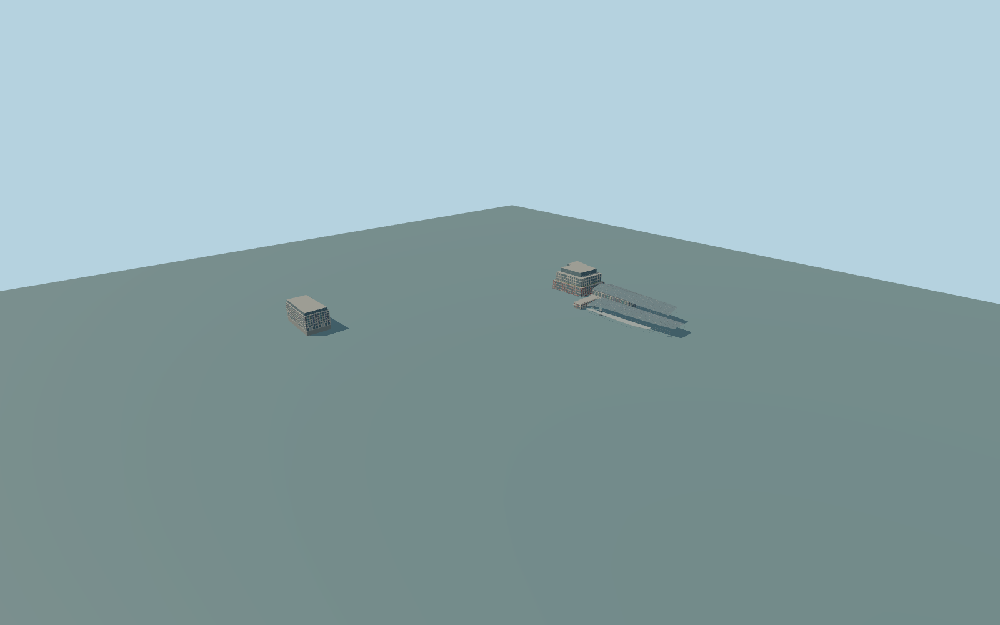

# Farringdon station

Complete Farringdon aboveground interchange exterior:both whole mapped main arched platform-canopy sections andwestern glazed long roof,heritage Cowcross headhouse/annexes andprojecting glass/metal canopy,modern west mainline ticket hall/lifts,Bloom western Elizabeth-line entrance host andthe separate Kaleidoscope eastern entrance host nearLindseyStreet/LongLane. Preserve theindependent cityblocks,SmithfieldMarket halls,Barbican station,roads/alleys andintervening ground. No underground platform/tunnel interior,trains,people,signs,roundels,logos or obsoleteconstruction pit.

Rebuild: `node packages/worldgen/scripts/generate-farringdon-station.mjs`;append `--check` for exact source bytes. Select import/LOD/placement with `--ids=farringdon_station`. Detailed source and four browser tiers are separate ignored GLB outputs.

Complete Farringdon aboveground interchange exterior:both whole mapped main arched platform-canopy sections andwestern glazed long roof,heritage Cowcross headhouse/annexes andprojecting glass/metal canopy,modern west mainline ticket hall/lifts,Bloom western Elizabeth-line entrance host andthe separate Kaleidoscope eastern entrance host nearLindseyStreet/LongLane. Preserve theindependent cityblocks,SmithfieldMarket halls,Barbican station,roads/alleys andintervening ground. No underground platform/tunnel interior,trains,people,signs,roundels,logos or obsoleteconstruction pit.

Maplayer2 doesnot establish surveyed raillevels. Main barrel8m eaves/12m crown,west14m eaves/20m crown,heritage8m andsecondary5m canopies areexplicit picture/map interpretations. WesternBloom height34m isphoto-estimated because nativeheightisabsent;native easternhost23m isretained. Host associations arephysicalpicture/map fits,not separately Wikidata-tagged identities. Exact undergroundstation interiors andheritage lettering areomitted. Main canopy8m eaves/12m crown andwestglazed gable14/20m use one consistent heightfunction forpanes/ribs,clippedtotheactualnative plans. Heritage8m,modernhall14m,lowcanopies5m,lifts8m;Bloom16mred/28mpale/34mglazedcrown estimate,Kaleidoscope5mground/19.5moffice/23mnativecrown. One unchanged standard global field sample outside Cowcross at[30.036685,-140.665552],7.685114543304351m,defines commonY=0. Bloom andKaleidoscope sourcegrades are fixed offsets -0.7193549093385991/7.202273056283683m fromtheir own outsidefield samples;no per-part runtime host offsets orflattening. Floors are their grade+.65m;exactthresholds unsurveyed.

Four ordinary exterior pictures andcurrentPMTiles. The2012 aerial establishesmaincanopy family,not currentBloomconstructionstatus;obsoletepit omitted. Bloom andeastentrance host associations,hidden/rearfacades,floor inventories,canopy profiles andframe counts are explicit medium-fi interpretations. No copied facadeetching/signs. Exact rail-platform grades,thresholds,stairs andnavigable undergroundinteriors areunverified. Physical laptop/phone timing andnumericalLODerrors remainunmeasured.

Seven existing shared256px graphs:stone_limestone,clay_fired,stone_granite,metal_standing_seam,metal_painted,window_grid andmembrane;one palette roof group forlowgreenplanting. Atmost8mergedsemantic groups,metricUVs,linearcolors;zero embedded/private images. Only actual windows andglazed canopies usewindow graph;opaque stone,claypanels,steel androofs keepsemantics. Skyline preservesboth wholecanopyfamilies,heritage/modernhalls andbothcompleteheight-steppedentrancehosts. Districtaddscoarsepanes andribs;streetaddsrealrecesses andsampledstructuralframes;closeupaddsfullwindowbays,canopyribs/supports,redheritageframes,cornicebrackets,hostcoloredinfills andfins. Detailedmaster separatelyrefines roofmeshes,frames,seams andreveals.

Original geometry:repository license. Map:© OpenStreetMap contributors,ODbL-1.0;Protomaps. Standard terrain:terrain-grid.json. Ordinary pictures stay local and are not redistributed or used as textures. Current acceptance:qa.json.
