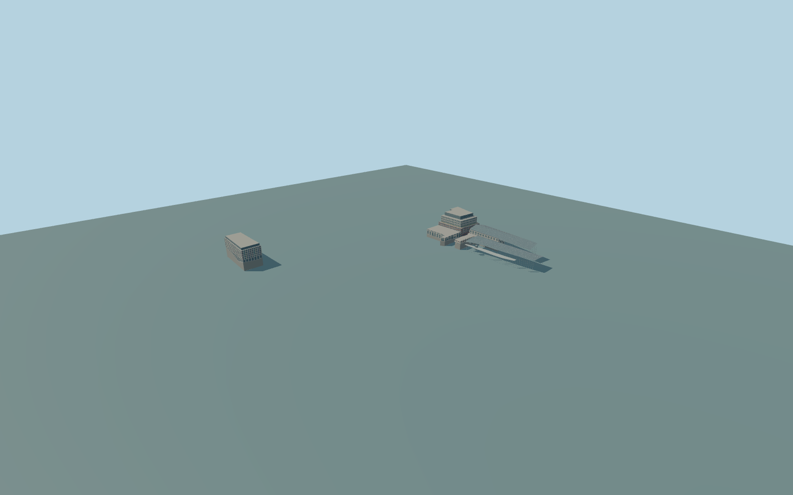

# Farringdon station

Farringdon’s two glazed canopy families, Cowcross heritage entrance and modern mainline hall, low western ticket hall and Bloom offices, and the complete Kaleidoscope eastern host including its Long Lane corner wing.

Rebuild: `node packages/worldgen/scripts/generate-farringdon-station.mjs`;append `--check` for exact source bytes. Select import/LOD/placement with `--ids=farringdon_station`. Detailed source and four browser tiers are separate ignored GLB outputs.

The short thresholds, aprons and lobby recesses approximate current street grades using the standard host terrain and PMTiles pavement. Canopy profiles and underground rail levels are visual estimates.

The western low ticket hall roof and Bloom height are inferred from current street and aerial photographs. The model shows the above-ground building envelopes and recessed doors. Platform interiors, escalators, train service and street furnishings use the host scene.

Original geometry:repository license. Map:© OpenStreetMap contributors,ODbL-1.0;Protomaps. Standard terrain:terrain-grid.json. Ordinary pictures stay local and are not redistributed or used as textures. Current acceptance:qa.json.
