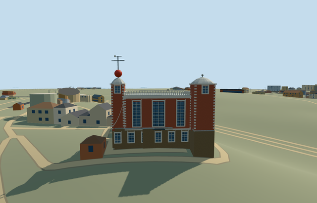

# flamsteed_house_royal_observatory_greenwich — Flamsteed House, Royal Observatory Greenwich

Reviewed2026-10-22. **Completed medium-fi exterior with approximate native placement; Observatory collection remains1/7.**

## Built and inspected

Independent Flamsteed House: mapped low museum range and canted tall room, twin square corner turrets with domed lead-colored caps, northeast red time ball and signal mast, tall window rhythm, stone quoins/cornices and complete roof balustrade returns, small north balcony and genuine recessed low eastern entry with closed soffit/floor. Three ordinary pictures and standard PMTiles guided one continuous author/inspect/fix pass. Corrected disconnected trim, missing rear balustrade returns/rear light, the visibly banded Flemish graph with the existing general brick surface, shared brick color and mast framing before final captures.

## Shared materials and browser LODs

Four existing256px shared graphs over eight roles: brick upper red brick and low range/base, stone_limestone_raw modeled trim, metal_painted roof/frames/mast/red ball, storefront opaque glass. Five textured draws and one skyline draw. No new graph, private atlas or embedded image. The graph supplies low-frequency brick/glass style, with geometry carrying the landmark silhouette. Linear tints, metric UVs and shared lifetime used; every graph reads once per native run and all model geometry disposes on unload.

| Level | Triangles | Bytes | Draws |
| --- | ---: | ---: | ---: |
| skyline | 960 | 88700 | 1 |
| district | 3908 | 353904 | 5 |
| street | 8300 | 749636 | 5 |
| closeup | 9428 | 851156 | 5 |

Four authored LODs:960 /3908 /8300 /9428 triangles. Initial skyline plus district geometry442604 bytes, close-up851156 bytes. Separate POSITION/NORMAL streams and equal CPU/GPU accounting. Six GLBs with zero Khronos errors/warnings,54 actual mesh/contact probes and three actual PMTiles13/14/15 overlap cases. Inspected48 current source/shared/context/LOD/native frames, including Economy/High, noon/late light, silhouette and unloading/failure views. Physical device/dense-city timings remain pending.

## Geographic placement

Approximate exterior native fit accepted. Shared Observatory Q192988 plus unique way268533444/native35184640622276 identifies Flamsteed House; the time-ball point supports the northeast turret. Independent building anchor[-0.0019658245675457297,51.477950113986935], heading0 with mapped east-northeast/south-southeast orientation baked into native east/south coordinates. Replaces only its own footprint, retaining all1301 independent resident/1838 wider buildings, including the six other required Observatory members. Original201x201/6m grid, roads and9681.379312m² water retained. Occupied floor cutout only; court, provider and northern approach keep original terrain. Boundary grade -2.47..+0.18m relative to court leaves a hillside brick base rather than flattening the site. Failure retains all1302 originals; all four LOD unloads restore ground/water with zero live model geometry. Exact retaining walls, terrace excavation, thresholds, walking clearance/accessibility remain approximate.

## Fidelity and limits

Medium-fi photo-led exterior, with no mapped height control: low range4.1m, tall room11.8m, turret15m, caps16.6m and roughly22m signal top are working estimates. Roof curves, window/stone inventories, balcony, ramped trim and hidden southern/canted walls are simplified. The ball and vane are static, glass opaque, no furnished instruments/rooms, operating mechanisms, copied lettering, inscription, mural or sign art. Detached eastern pavilion, Meridian/Equatorial buildings, Altazimuth, South Building and planetarium remain separate required assets; this member does not complete the Observatory candidate.

## Targeted checks

Selected source generation/import/placement, strict medium-fi, scene validation and sim30 pass. Sim30 sha256:d58afa15ecabce56a5cceefcedfb225cc10903419169575701fe4713954230a1. Collection tests11+4 and recipe lint pass. Pins: [qa.json](qa.json). Source controls: [map-frame.json](map-frame.json).

## Viewed references

- https://commons.wikimedia.org/wiki/File:Flamsteed_House_Greenwich_2023_01.jpg — Julian Herzog; 2023-11-17; CC-BY-4.0. Viewed only; no copied pixels.

- https://commons.wikimedia.org/wiki/File:Flamsteed_House_-_Royal_Observatory_Greenwich_(8131031429).jpg — Elliott Brown; 2012-10-14; CC-BY-2.0. Viewed only; no copied pixels.

- https://commons.wikimedia.org/wiki/File:Flamsteed_House_Royal_Observatory_from_National_Maritime_Museum_colonnade_Greenwich_London_England_02.jpg — Acabashi; 2025-11-30; CC-BY-SA-4.0. Viewed only; no copied pixels.

- https://www.openstreetmap.org/way/268533444 — independent house footprint, ©OpenStreetMap contributors ODbL-1.0. Standard PMTiles/Mapzen, no bespoke terrain research.

## Completion checklist

- [x] Source rebuild, import, four authored LODs and existing shared materials.
- [x] Current actual source/shared/native views, geometry and lifecycle checks.
- [x] Independent identity, map orientation and approximate hillside placement.
- [ ] Six other required Observatory members.
