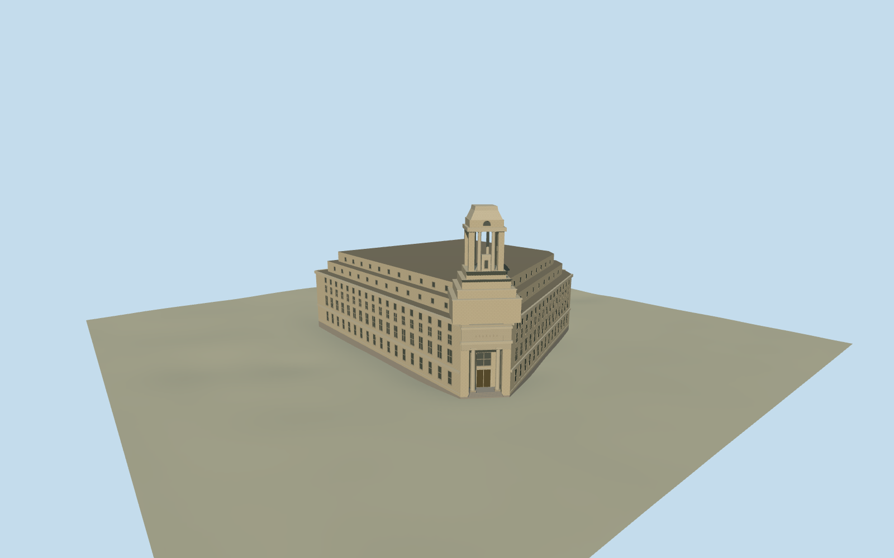

# Freemasons' Hall, London

Freemasons’ Hall on Great Queen Street with its Portland stone street walls, recessed classical entrance, stepped attics and open corner tower.

Authoring state: **review-in-qa.json**. Current completion evidence is in [qa.json](qa.json) and the [completion ledger](../../../../qualla-structures/batches/qualla-004.PROGRESS.md).

- [Freemasons' Hall, London](https://qualla.com/freemasons-hall-london/)

The current main hall exterior, including its tower and attic levels. Adjacent addresses and interior halls are outside scope.

Tower and attic heights, hidden rear openings and fine carving are estimated from the photographs and listing.

Build: `node content/worldgen/source/places/gc/gcp/freemasons_hall_london/models/generate-freemasons-hall-london.mjs`. Add `--check` to verify exact regeneration. 13613 triangles; 6 materials; no embedded photographs.
