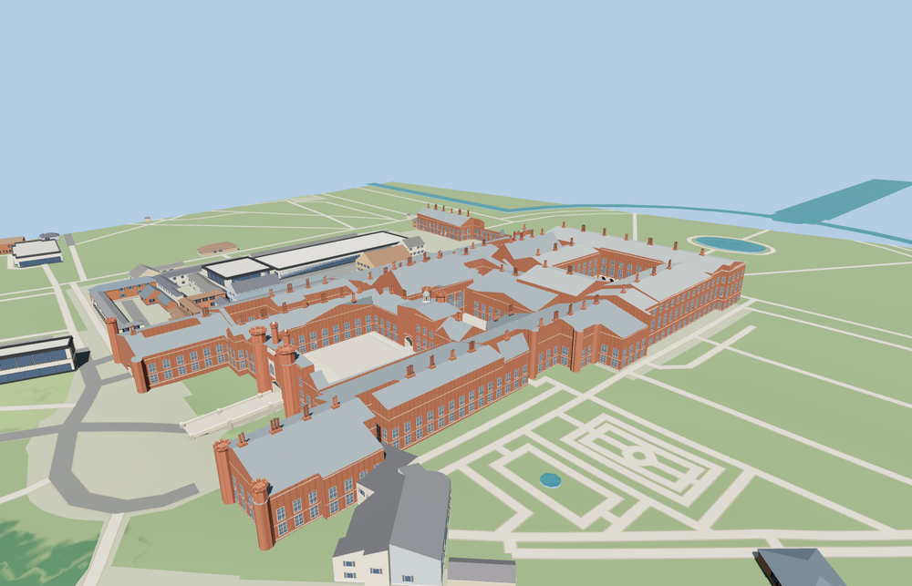

# Hampton Court Palace

The Tudor Great Gatehouse and moat bridge open into Base Court, with Anne Boleyn’s Gateway and the astronomical clock between it and Clock Court. The Great Hall and Chapel Royal rooflines meet the Baroque east front, Fountain Court arcades and the northern Royal Tennis Court range.

The 29,708-triangle source rebuilds byte for byte. Skyline, district, street and close-up use 978, 3,633, 11,746, 26,450 triangles. Skyline and district total 382,656 bytes. Six GLBs validated and 36 current views were inspected.

All four tiers pass seven court-floor, three roof, three gate and six bridge probes. The bridge meets the Great Gatehouse without a deck step, and the Fountain Court arcade remains open. The stone basin follows the mapped water outline. The viewer retains 43 independent building records and 180 transportation records. Failed loading restores the palace, hall and chapel footprints.

The palace perimeter, seven court voids, named hall and chapel footprints, and three mapped passage centerlines use PMTiles. Standard viewer terrain determines the gate, bridge and court levels. Roof pitches, chimney positions, window subdivisions, the heraldic stonework and the astronomical dial are exterior reconstructions from ordinary photographs. The fountain is static and rooms beyond the open passages and cloister are outside the scope.

Rebuild with `node packages/worldgen/scripts/generate-hampton-court-palace.mjs`. Append `--check` to compare exact bytes. Use `--ids=hampton_court_palace` for targeted import, LOD, placement and readiness.
