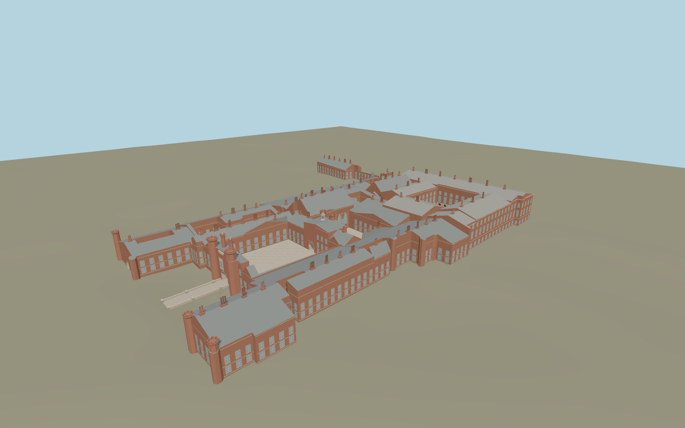

# Hampton Court Palace

The Tudor Great Gatehouse and moat bridge open into Base Court, with Anne Boleyn’s Gateway and the astronomical clock between it and Clock Court. The Great Hall and Chapel Royal rooflines meet the Baroque east front, Fountain Court arcades and the northern Royal Tennis Court range.

Run `node packages/worldgen/scripts/generate-hampton-court-palace.mjs` to rebuild the source master. Append `--check` to compare the exact bytes. Use `--ids=hampton_court_palace` for targeted import, LOD generation and placement.

The palace perimeter, seven court voids, named hall and chapel footprints, and three mapped passage centerlines use PMTiles. Standard viewer terrain determines the gate, bridge and court levels.

Roof pitches, chimney positions, window subdivisions, the heraldic stonework and the astronomical dial are exterior reconstructions from ordinary photographs. The fountain is static and rooms beyond the open passages and cloister are outside the scope.

Original geometry follows the repository license. Map data is © OpenStreetMap contributors under ODbL-1.0 via Protomaps. Terrain samples are described in terrain-grid.json. Ordinary pictures stay local and are not redistributed or used as textures. Current acceptance is recorded in qa.json.
