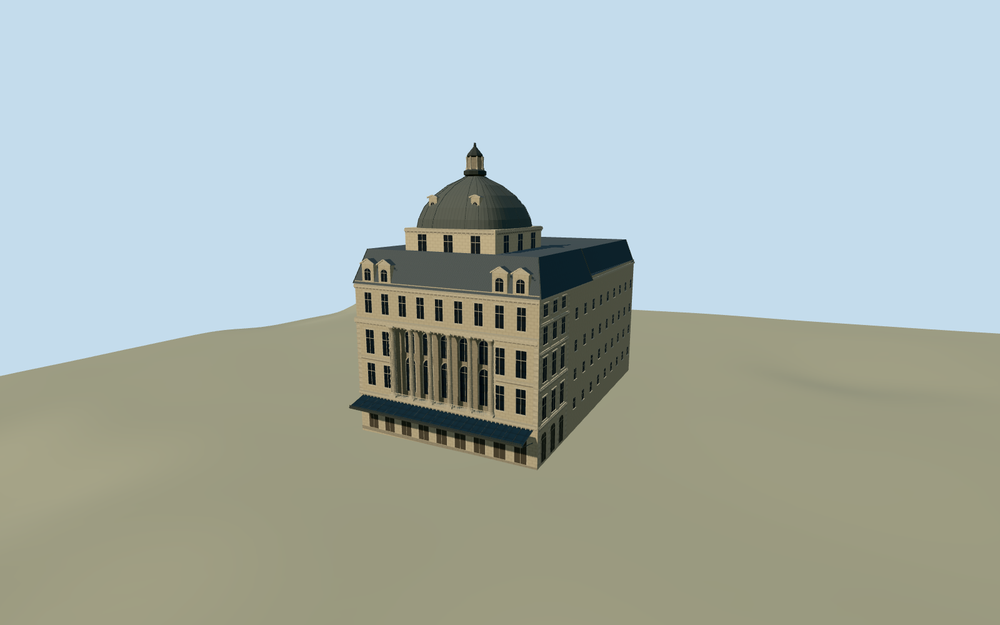

# His Majesty's Theatre, London

His Majesty’s Theatre on Haymarket with its nine-bay limestone façade, five-bay giant Corinthian loggia, glazed iron canopy, pedimented mansards, square French dome and octagonal lantern.

Authoring state: **review-in-qa.json**. Current completion evidence is in [qa.json](qa.json) and the [completion ledger](../../../../qualla-structures/batches/qualla-003.PROGRESS.md).

- [His Majesty's Theatre, London](https://qualla.com/his-majesty-s-theatre-london/)

The model follows the surveyed footprint and the listed façade arrangement. Floor and roof heights, rear roof massing, column capitals and carved stone ornament are estimated.

The exterior omits commercial show graphics, the civic crest, interiors and the separately mapped adjacent Royal Opera Arcade.

Build: `node content/worldgen/source/places/gc/gcp/his_majesty_s_theatre_london/models/generate-his-majesty-s-theatre-london.mjs`. Add `--check` to verify exact regeneration. 13501 triangles; 8 materials; no embedded photographs.
