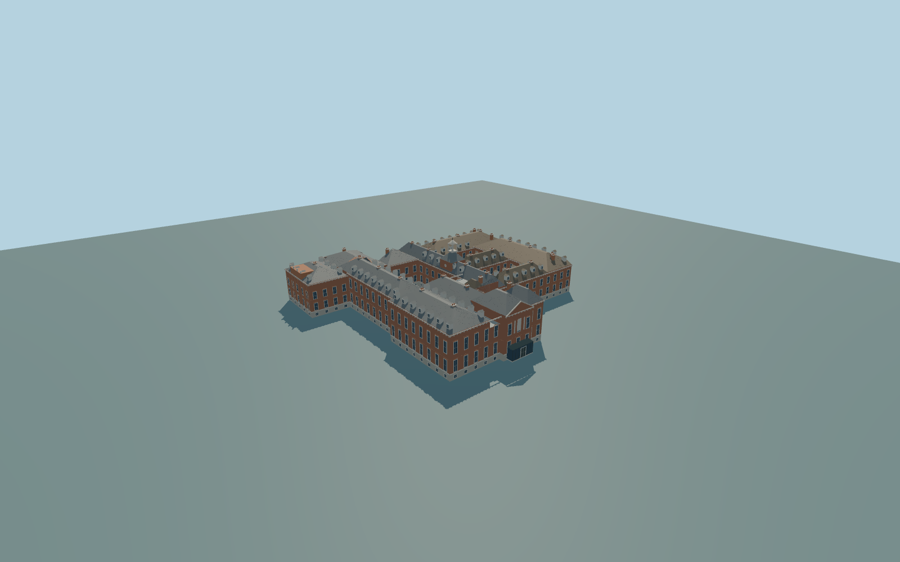

# Kensington Palace

Complete individual Kensington Palace principal exterior and attached east glazed canopy: three real open courts, connected State Apartments and northern private ranges, east pediment and pale basement strip, south gallery pilasters/raised urn attic, hipped and dormered roofs/large chimneys, clock stage and open white lantern above a deep closed-back entry recess. Gardens,gates,independent statues/cottages andinteriors remain context.

Rebuild: `node packages/worldgen/scripts/generate-kensington-palace.mjs`;append `--check` for exact source bytes. Select import/LOD/placement with `--ids=kensington_palace`. Detailed source and four browser tiers are separate ignored GLB outputs.

Complete individual Kensington Palace principal exterior and attached east glazed canopy: three real open courts, connected State Apartments and northern private ranges, east pediment and pale basement strip, south gallery pilasters/raised urn attic, hipped and dormered roofs/large chimneys, clock stage and open white lantern above a deep closed-back entry recess. Gardens,gates,independent statues/cottages andinteriors remain context.

Picture-guided original relative heights on an approximate23m standard global viewer reference,not surveyed floor/eave levels. Three court paving levels follow the unchanged standard field approximately;foundations/entry transitions must be fitted to that field without global flattening. Fine inventories andhistoric levels remain approximate.

Original approximations of fine relief,urns/clock details,dormer/chimney/window inventories,hidden roof joints andinterior levels. No copied royal arms,inscriptions,sculptures orprivate textures. Exterior only;the deep clock-court recess has closed rear doors because the pictures do not prove a through passage. Physical laptop/phone timing andLOD error estimates remain unmeasured.

Seven existing 256px brick,limestone,granite,slate,painted metal,window grid andpainted wood graphs;metric UVs andlinear colors. Skyline preserves the whole palace,three courts,clock stage/lantern andentry steps. District adds sparse sash glazing. Street adds dormers. Close-up adds cornices,urns andwindow frames;master retains fine profiles/roof seams. Clipped planar hip roofs preserve native notches andall three court voids. Error estimates3/1.5/.7/.25m andphysical timing remain unmeasured.

Original geometry:repository license. Map:© OpenStreetMap contributors,ODbL-1.0;Protomaps. Standard terrain:terrain-grid.json. Ordinary pictures stay local and are not redistributed or used as textures. Current acceptance:qa.json.
