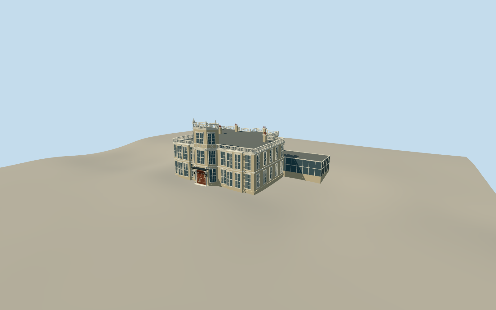

# 13 Kensington Palace Gardens

Buff masonry residence with two-storey wings, projecting three-storey entrance bay, white sash surrounds, open quatrefoil parapets, flat roof, chimneys and lower glazed south conservatory.

Authoring state: **review-in-qa.json**. Current completion evidence is in [qa.json](qa.json) and the [local 100 ledger](../../../../qualla-structures/batches/PROGRESS.md).

- [13 Kensington Palace Gardens](https://qualla.com/13-kensington-palace-gardens/)

Original medium-fi surviving exterior from a local 2014 Qualla facade photo and generalized map controls; no measured survey or interior.

Buff masonry, white sash surrounds, entrance bay and open parapet rhythm are represented. Fine carvings, exact tracery and secondary elevation openings are simplified interpretations.

The former bell turret and earlier pitched roof are omitted following the article description of the 1924 alteration. The southern glazed conservatory and hidden roof/rear details are conservative interpretations.

Independent coarse terrain determines host contact. The ambassadorial flag, garden hedges, security fixtures, surrounding streets and interiors are omitted. Local reference photography is not embedded or redistributed.

Build: `node packages/worldgen/scripts/generate-authored-places.mjs --ids=kensington_palace_gardens_13`. Add `--check` to verify exact regeneration. 44448 triangles; 5 materials; no embedded photographs.
